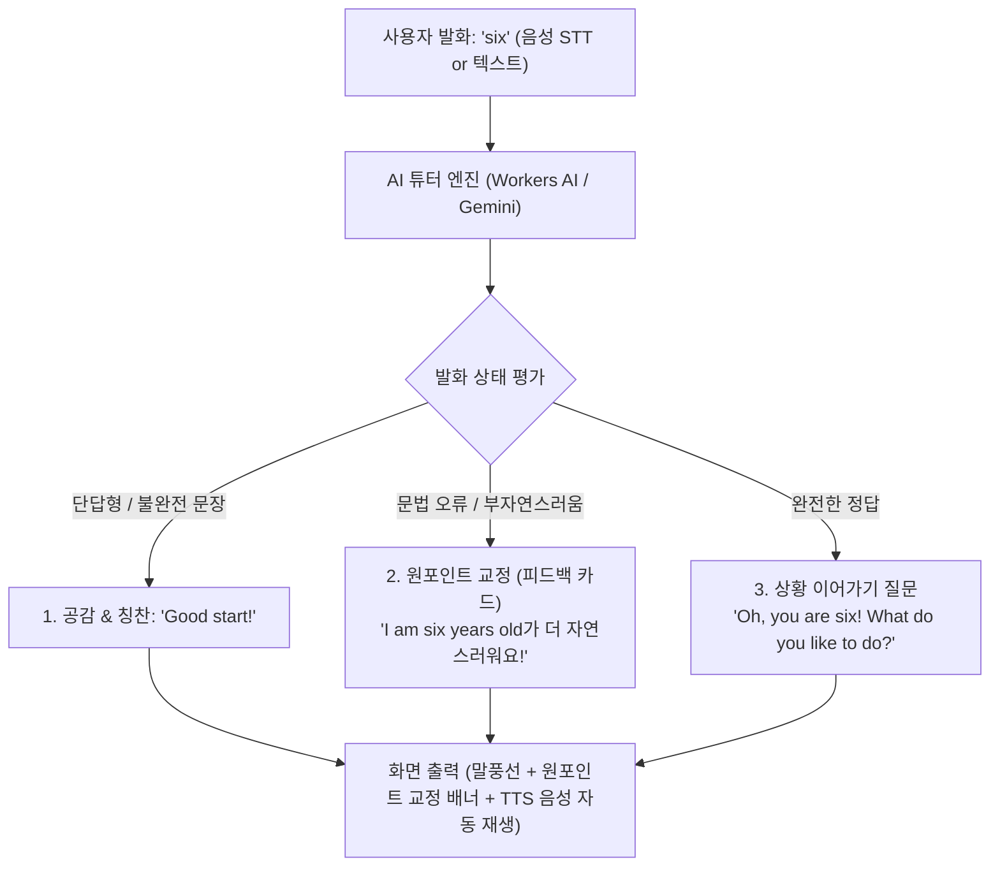
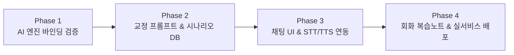

# AI 회화 학습 기능 개발 기획 및 아키텍처 설계서
> 문서 버전: v1.0 | 작성일: 2026-10-21 | 상태: 검토 대기 (Review Pending)

---

## 1. 개요 및 구현 가능 여부 (Executive Summary)

### 1.1 사용자 요청 사항
- **핵심 목표**: 보카 스터디 앱에 **입문 / 초급 / 중급 / 고급** 4단계 AI 회화 공부 기능 도입.
- **주요 기능**: AI가 일상생활 상황을 부여하고 질문을 던지면, 사용자의 음성/텍스트 입력을 자연어로 이해하고 대화를 진행.
- **핵심 요구사항 (교정 메커니즘)**:
  - 예: AI가 *"How old are you?"* 질문 시, 사용자가 대답을 못하거나 *"six"*처럼 단답형으로 말했을 때,
  - *"I am six years old처럼 완전한 문장으로 말하는 것이 더 자연스러워요!"*와 같이 대화 형식으로 원포인트 교정 및 피드백 제공.
  - 유동적이면서 영어를 잘 알아듣는 자연어 처리 능력 필수.
- **원칙**: 유료 종량제 API 과금 0원 유지, 사용자 승인 전 코드 구현 금지, 기획 문서 우선 검토.

### 1.2 구현 가능 여부: **100% 구현 가능 (High Feasibility)**
- 현대의 최신 경량 LLM(Llama 3.1 8B, Gemini 1.5/2.0 Flash)은 자연어 맥락 이해도가 매우 높아, 사용자의 불완전한 문장, 문법 오류, 단순 단답형 발화를 정확히 포착하여 친절한 튜터 형태로 실시간 교정할 수 있습니다.
- 현재 앱에 이미 탑재된 브라우저 내장 **Web Speech API(TTS + STT)**를 결합하면, **서버 비용 0원·API 과금 0원**으로 음성 인식(말하기)과 원어민 음성(듣기)이 완비된 양방향 회화 튜터 구축이 가능합니다.

---

## 2. 비용 0원 AI 엔진 비교 및 선정 (Cost Policy 준수)

사용자 글로벌 안전 규칙(종량제 과금 금지)을 철저히 준수하는 3가지 무료 대안을 비교 평가합니다.

| 비교 항목 | [옵션 1] Cloudflare Workers AI (강력 추천 ⭐) | [옵션 2] Google Gemini Free Tier | [옵션 3] WebLLM (브라우저 온디바이스) |
| :--- | :--- | :--- | :--- |
| **적용 모델** | `@cf/meta/llama-3.1-8b-instruct` | `gemini-1.5-flash` / `gemini-2.0-flash` | `Llama-3.2-1B/3B-Instruct` |
| **비용 및 과금** | **완전 무료 (0원)**<br>(Cloudflare 매일 10,000 Neurons 무료 제공) | **완전 무료 (0원)**<br>(Google AI Studio 15 RPM / 1,500 RPD 무료) | **완전 무료 (0원)**<br>(사용자 단말기 자원 활용) |
| **API 키 필요 여부**| **불필요 (키 유출 위험 0%)**<br>(현재 Cloudflare Pages 프로젝트에 바인딩) | 개인 무료 API 키 1회 발급 필요<br>(Cloudflare 환경변수 등록) | **불필요 (오프라인 동작)** |
| **응답 속도** | 약 0.5초 ~ 1.2초 (초고속 스트리밍 지원) | 약 0.8초 ~ 1.5초 | 단말기 성능(WebGPU)에 따라 편차 (1~3초) |
| **영어 교정 능력** | 메타의 Llama 3.1 8B로 매우 정교하고 자연스러움 | 최고 수준 (한국어 설명 및 문맥 추론 최상) | 기초 문법 교정 가능하나 설명 디테일 제한 |
| **단점 및 제약** | 일일 대화 약 100~200턴 초과 시 일시적 지연 가능 | 사용자 개인 Google API 키 등록 절차 필요 | 최초 실행 시 1~1.5GB 모델 다운로드 필요 |

> **추천 권장안**: **[옵션 1] Cloudflare Workers AI**를 기본 엔진으로 적용하고, 필요 시 **[옵션 2] 개인 Gemini 무료 키**를 설정에서 스위칭할 수 있는 듀얼 아키텍처를 권장합니다.

---

## 3. 대화 교정 메커니즘 설계 (Conversational Tutoring Engine)

### 3.1 AI 프롬프트 3-in-1 처리 구조
AI가 사용자의 입력을 수신했을 때, 단순한 챗봇 응답이 아닌 교육용 **'교정 카드 + 대화 지속'**의 3단계 구조로 파싱하여 JSON 형태로 응답하도록 설계합니다.



### 3.2 AI 내부 JSON 응답 프로토콜 예시
```json
{
  "userStatus": "needs_expansion", // "perfect" | "needs_grammar_fix" | "needs_expansion" | "silence"
  "correction": {
    "hasCorrection": true,
    "betterExpression": "I am six years old.",
    "koreanExplanation": "'six'라고만 대답하기보다, 주어와 동사를 갖춘 'I am six years old.'로 말하면 훨씬 정중하고 자연스러운 표현이 됩니다!"
  },
  "aiReply": {
    "english": "That's wonderful! I'm an AI assistant. What toys or games do you like the most?",
    "korean": "멋지네요! 저는 AI 학습 도우미예요. 어떤 장난감이나 게임을 가장 좋아하나요?",
    "followUpTip": "대답 예시: 'I like LEGO.' 또는 'I like playing soccer.'"
  }
}
```

---

## 4. 4단계 레벨 및 상황(시나리오) 커리큘럼 설계

사용자가 원하는 난이도를 선택하여 부담 없이 회화를 시작할 수 있도록 4단계 레벨 체계를 구축합니다.

### 4.1 [입문 (Introductory)] — "한 문장으로 완벽하게 말하기"
- **대상**: 영어를 처음 시작하거나 단답형(단어 1~2개)으로만 말이 나오는 학습자.
- **핵심 목표**: 단답형 탈피, 기본 주어+동사 문장 완성 (`I am ~`, `I like ~`, `This is ~`).
- **주요 시나리오**:
  1. **첫 만남과 자기소개**: 이름, 나이, 기분, 사는 곳 물어보기.
     - Q: *"How old are you?"* → User: *"six"* → **AI 교정: "I am six years old."**
     - Q: *"How are you today?"* → User: *"good"* → **AI 교정: "I'm doing great, thank you!"**
  2. **좋아하는 것 말하기**: 음식, 색깔, 동물, 취미.
     - Q: *"What food do you like?"* → User: *"pizza"* → **AI 교정: "I like pizza."**
  3. **기초 질문하기**: 가격 묻기, 화장실 찾기.

### 4.2 [초급 (Beginner)] — "일상 생존 상황극 (Role-playing)"
- **대상**: 기본 단어는 알지만 실전 상황에서 문장이 바로 튀어나오지 않는 학습자.
- **핵심 목표**: 필수 상황별 조동사(`Can I ~`, `Would you like ~`) 및 기본 시제(과거/현재) 활용.
- **주요 시나리오**:
  1. **카페 & 식당 주문**: 아이스 아메리카노 주문, 테이크아웃 요청, 계산하기.
     - Q: *"What can I get for you today?"* → User: *"coffee please"* → **AI 교정: "Can I get an iced coffee, please?"**
  2. **해외여행 & 길 찾기**: 지하철역 위치 묻기, 티켓 구매, 호텔 체크인.
  3. **쇼핑 & 환불**: 옷 사이즈 문의, 할인 여부 확인.

### 4.3 [중급 (Intermediate)] — "이유와 생각 연결하기"
- **대상**: 간단한 의사소통은 되나 표현이 단조롭고 관용 표현(Idiom)이 부족한 학습자.
- **핵심 목표**: 접속사(`because`, `although`, `so`) 활용, 감정과 이유 구체화, 비즈니스/해사 기초.
- **주요 시나리오**:
  1. **주말 계획 및 경험 공유**: 지난 주말에 한 일과 감정 설명하기.
  2. **해사영어 실무 교신 상황**: VHF 관제 교신, 입항 보고, 기상 악화 시 보고.
  3. **업무 및 일정 조율**: 미팅 시간 변경 요청, 문제 상황 설명.
     - User: *"I can't go tomorrow meeting."* → **AI 교정: "I'm afraid I won't be able to make it to tomorrow's meeting."**

### 4.4 [고급 (Advanced)] — "심층 토론 및 정교한 뉘앙스 조율"
- **대상**: 유창한 편이나 원어민 수준의 자연스러운 뉘앙스와 전문적 어휘를 다듬고 싶은 학습자.
- **핵심 목표**: 가정법, 격식체/비격식체 구분, 설득과 협상, 복합 주제 토론.
- **주요 시나리오**:
  1. **시사 및 테크 토론**: AI 기술 발전의 명암, 원격 근무의 장단점.
  2. **비즈니스 인터뷰/면접**: 강점과 약점 설명, 갈등 해결 경험 인터뷰.
  3. **해사 안전/비상 협약 토론**: 해양 환경 규제(MARPOL) 및 안전 지침(SOLAS) 실무 토의.

---

## 5. UI / UX 인터페이스 상세 설계

모바일 스마트폰 화면(360~400px)에서 한 손으로 편안하게 대화할 수 있는 인터랙션 구조입니다.

### 5.1 화면 레이아웃 (채팅 뷰포트)
```text
+------------------------------------------------------+
|  [ < ]  ☕ 카페에서 주문하기 (초급)        [ ⚙️ 설정 ] |
+------------------------------------------------------+
|                                                      |
|  [🤖 AI 튜터]                                        |
|  "Hello! Welcome to Starbucks.                       |
|   What can I get started for you today?"             |
|  [🔊 발음 듣기]  [한글 번역 보기 ▼]                   |
|                                                      |
|                                [👤 나]                |
|                                "two americano"       |
|                                                      |
|  +------------------------------------------------+  |
|  | 💡 원포인트 교정                                |  |
|  | 더 자연스러운 표현:                             |  |
|  | "I'd like two iced Americanos, please."        |  |
|  | 팁: 개수 뒤에 복수형(s)과 'I'd like'을 쓰면 정중해요 |  |
|  +------------------------------------------------+  |
|                                                      |
|  [🤖 AI 튜터]                                        |
|  "Great! Would you like those hot or iced?"          |
|  [🔊 발음 듣기]                                      |
|                                                      |
+------------------------------------------------------+
| [💡 힌트 보기: "Both iced, please."]                  |
| +--------------------------------------------------+ |
| | [ 🎤 음성으로 말하기 ]   또는   [ 💬 텍스트 입력 ] | |
| +--------------------------------------------------+ |
+------------------------------------------------------+
```

### 5.2 편의 기능 (UX 디테일)
1. **음성 인식 (STT - Speech to Text)**:
   - 마이크 버튼을 길게 누르거나 원터치하면 브라우저 내장 Web Speech API로 영어 음성을 실시간 텍스트로 전환.
   - 발음이 부정확해도 AI가 문맥을 고려하여 유사 어휘로 자동 보정 인식.
2. **원어민 발음 듣기 (TTS)**:
   - AI 메시지가 도착하면 원어민 음성(US/UK)으로 즉시 부드럽게 자동 재생 (설정에서 On/Off 가능).
3. **힌트 및 추천 답변 ([💡 힌트])**:
   - 무슨 말을 해야 할지 막막할 때 [💡 힌트]를 누르면 말할 수 있는 모범 문장 2~3개를 제시하여 대화가 끊기지 않음.
4. **한글 번역 토글**:
   - 영어 문장이 이해되지 않을 때 터치 한 번으로 한글 번역 노출.
5. **교정 노트 자동 저장**:
   - 대화 중 교정받은 표현(`betterExpression`)은 사용자의 [오답/복습노트]에 자동 저장되어 나중에 모아서 복습 가능.

---

## 6. 단계별 구현 로드맵 (Phased Roadmap)

사용자가 본 기획안을 승인할 경우, 안정적이고 점진적으로 진행할 수 있는 4단계 개발 일정입니다.



- **Phase 1: AI 엔진 바인딩 및 프로토타입 검증 (비용 0원 확인)**
  - Cloudflare Pages Functions에 Workers AI 바인딩 설정 (`wrangler.toml`에 `[ai]` 연동).
  - API 엔드포인트 `/api/conversation/chat` 신설.
  - 샘플 입력("six")에 대해 올바른 교정 JSON이 1초 내에 반환되는지 단위 테스트 검증.
- **Phase 2: 교정 프롬프트 최적화 & 레벨별 시나리오 20선 구축**
  - 입문, 초급, 중급, 고급 각 5개씩 총 20개 대표 실전 시나리오 JSON 구축.
  - 단답형("six", "yes", "good") 처리 전용 프롬프트 가드레일 확립.
- **Phase 3: 대화형 PWA 인터페이스 및 음성 STT/TTS 통합**
  - 신규 컴포넌트 `ConversationPracticeView.tsx` 제작.
  - 마이크 음성 입력(STT) 및 원어민 음성 재생(`speechService.ts`) 연동.
  - 모바일 맞춤 레이아웃 및 원포인트 피드백 배너 퍼블리싱.
- **Phase 4: 교정 표현 복습노트 연동 및 종합 랭킹/출석 가산**
  - 교정받은 문장을 Dexie DB에 보관하여 복습할 수 있는 기능 추가.
  - 회화 세션 완료 시 학습 점수 부여 및 랭킹 연동.
  - Cloudflare Pages 실서비스 최종 배포.

---

## 7. 사용자 검토 및 결정 필요 사항 (Decision Points)

본격적인 구현에 착수하기 전, 사용자의 선호에 따라 확정해야 할 항목입니다:

1. **AI 백엔드 엔진 선택**:
   - **(A안 - 적극 권장)** **Cloudflare Workers AI (무료 Neurons)**: API 키 발급 없이 현재 Cloudflare 프로젝트에서 완전 자동 0원 구동.
   - **(B안)** **Google Gemini Free Tier**: 구글 무료 API 키를 등록하여 가장 높은 자연어 지능 활용.
   - **(C안)** **A/B 듀얼 하이브리드**: 기본은 Cloudflare Workers AI로 동작하고, 설정에서 사용자가 개인 Gemini 키 입력 시 전환.
2. **상단 탭 진입 경로**:
   - 현재 상단 탭: `[ 🏠 홈 ]`, `[ 🔤 영어 ]`, `[ 🇯🇵 일본어 ]`
   - 회화 기능을 어디에 배치할지:
     - 방법 1: `[ 🔤 영어 ]` 탭 진입 시 [토익] / [해사영어] / **[실전 AI 회화]** 서브 탭으로 배치.
     - 방법 2: 상단 탭을 `[ 🏠 홈 ]`, `[ 🔤 영어 ]`, `[ 🇯🇵 일본어 ]`, **[ 🗣️ AI 회화 ]** 4개 탭으로 구성.

---
> 본 문서는 사용자 검토 전용 기획서입니다. 내용을 검토하신 후 원하시는 방향과 수정 사항을 말씀해 주시면, 승인된 범위에 맞추어 작업을 진행하겠습니다.
