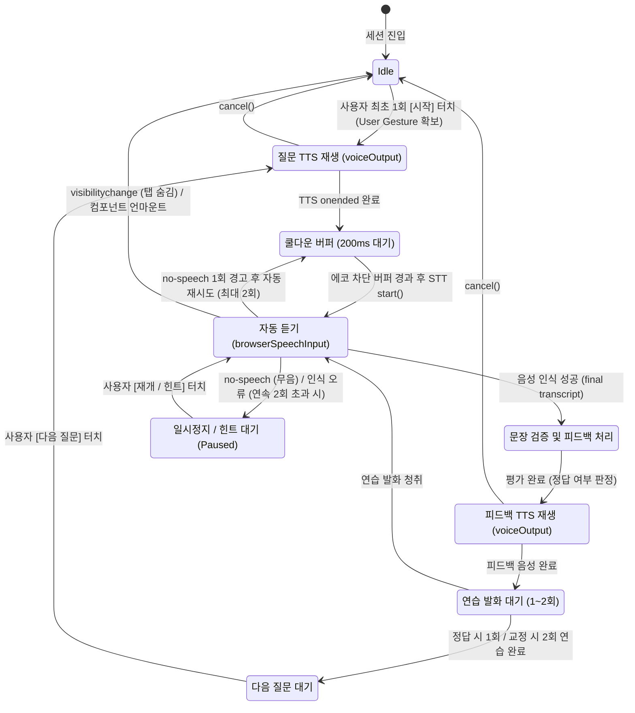

# FOLLOWUP-11: 모바일 핸즈프리(Hands-free) 회화 루프 설계 및 Web Speech API 구현 계획

> **작성일:** 2026-10-23 (KST)  
> **상태:** 기술 조사 및 설계 완료 · 클라이언트 서비스 프로토타입 작성 · **실기기 미검증(Unverified)**  
> **작성 역할:** Gemini IMPLEMENTER (검독: Codex)  
> **관련 문서:** `docs/ai회화/보카스터디_AI회화_통합개발계획_v2.2.md`

## Codex 감독 기준 보충

최초 `docs/AI_CONVERSATION_STUDY_PLAN.md`에도 Web Speech API 결합과 AI 응답 자동 음성 재생이 명시되어 있다. 최신 사용자 요구를 과거 계획에서 새로 확장한 기능으로 취급하지 않는다. 사용자 확인: **18세 이상 체크 한 번, 로그인 없이 공개**. AI 시험 참여 및 다중 동의 설정은 새 흐름에서 제거하고 처리 사실을 짧게 안내한다. 마이크 권한은 브라우저가 요구하며 앱에서 우회하지 않는다.

완료 순서:
1. Gemini 브라우저 음성 서비스/자동 TTS→STT 연결 구현, Codex 취소·오류·재시작·대기 상한 검증.
2. 배포한 연결 확인 화면에서 사용자 S25 Edge의 실제 질문 재생→자동 듣기→인식된 문장 재생 검증. 모의 시험을 실기기 성공으로 간주하지 않는다.
3. 확인된 음성 경로를 `초급→시작→질문→자동 답변 처리→원포인트 지도→연습 1회 또는 2회→다음`에 연결하고 복잡한 학습 단계를 정리.
4. 공개 API는 Access 대신 익명 호출 제한을 검증한 뒤 전환한다. 독립 D1의 90% 전역 예산, 중복 방지, 본문 크기/시간 제한은 유지한다. 기존 인증을 제거하고 무제한 키 프록시를 공개하지 않는다. Cloudflare 운영 Access 제거는 코드 검증 후 실제 변경 시점의 확인 절차로 진행한다.

`six`의 지도 예문은 질문 문맥에 맞는 `I am six years old.`다. 단답의 의미 이해와 이번 학습 목표의 완전 문장 연습을 구분한다. TTS 종료 후 듣기는 자기 음성 유입을 줄이는 설계이며 스피커 잔향까지 완전히 차단한다고 보장하지 않는다.

---

## 1. 기존 계획(v2.2)과 최신 사용자 요구사항 비교

| 항목 | 기존 계획 (`보카스터디_AI회화_통합개발계획_v2.2.md`) | 최신 사용자 요구사항 (2026-10-23) | 차이점 및 기술적 영향 |
|---|---|---|---|
| **입력 인터랙션** | 매 턴마다 마이크 버튼 클릭 → 녹음 → 텍스트 확인/수정 → 전송 버튼 클릭 | **최초 '시작' 1회 터치 후 자동 루프** (질문 TTS → 자동 STT 듣기 → 문장 인식 → 피드백 TTS) | 키보드 마이크/전송 버튼 반복 클릭 전면 금지. 화면 비주시 음성 학습 가능 환경 구축 |
| **STT 엔진** | 클라우드 `gemini-3.5-transcribe` (verbatim) 또는 PC 전용 `localSpeechInput` (`processLocally: true`) | 브라우저 기본 **Web Speech API (`SpeechRecognition`)** 기반 STT | 모바일 Chrome 호환성 확보, 앱 자체 Gemini STT API 쿼터 소모 0 |
| **턴 전환 제어** | AI가 다음 대화 진행을 매번 결정하거나 사용자 전송에 의존 | 사용자가 명시적으로 **'다음' 버튼을 누르면 다음 질문으로 전환** | 학습자의 호흡에 맞춘 단계적 진행 보장 |
| **단답 및 오답 판정** | 기획 원안의 무조건 교정 지양, 오류/확장 구분 | **"six" 등 의미상 맞는 단답은 정답 인정 후 문장 확장 지도** | 단답을 무조건 오답 처리하지 않고 자연스러운 문장("I have six books.")으로 유도 |
| **피드백 및 발화 횟수** | 정해진 턴 내에서 일괄 평가 | **정답/적합 시 문장 연습 1회, 교정 필요 시 2회 반복 연습** | 맞춤형 발화 훈련 루프 도입 |
| **인증/동의 UI** | 로그인 및 AI 시험 동의 필수 모달 | 로그인 및 AI 시험 동의 UI 제거 요청 접수 | **이번 단계에서는 서버 인증/공개 정책을 수정하지 않음** (안전 설계 선행 필요) |

---

## 2. Web Speech API 대안의 기술적 근거, 한계 및 원격 처리 고지

### 2.1 기존 `localSpeechInput`의 모바일 사용 불가 사유
기존 `src/features/conversation/services/localSpeechInput.ts`는 다음 제약으로 인해 모바일(Android Chrome 등)에서 기본 서비스로 사용할 수 없습니다:
1. **정적 검사 메서드 부재**: Android Chrome의 `SpeechRecognition`에는 `available()` 또는 `install()` 정적 메서드가 구현되어 있지 않아 호출 시 런타임 오류가 발생합니다.
2. **PC 환경 언어팩 의존성**: PC Chrome에서 `processLocally: true`를 강제할 경우 Windows/Chrome의 영어(en-US) 언어팩 미설치로 인해 초기화 실패가 빈번하게 발생합니다.
3. **사용자 제스처 유실**: `Constructor.available()` 등 비동기 `await` 검사를 거치는 동안 브라우저의 최초 터치(User Gesture) 컨텍스트가 만료되어 `recognition.start()`가 차단될 위험이 있습니다.

### 2.2 신규 `browserSpeechInput` 설계 원칙
- `window.SpeechRecognition || window.webkitSpeechRecognition` 표준 인터페이스 활용
- `processLocally` 플래그 강제 금지 (표준 브라우저 엔진에 위임)
- `recognition.start()`를 `await` 없는 **동기(Synchronous) 호출**로 실행하여 사용자 제스처 컨텍스트 유지
- `continuous = false`, `interimResults = false`, `lang = 'en-US'` 설정

### 2.3 원격(Remote) 처리 가능성 및 법적/기술적 한계 고지
- **원격 음성 처리 가능성**: 브라우저 내장 Web Speech API는 단말기 OS 및 브라우저 벤더(Google, Samsung, Apple 등)의 음성 인식 클라우드 서버를 경유하여 텍스트로 변환될 수 있습니다. 단, 이는 **브라우저 플랫폼의 자체 동작**이며, **본 애플리케이션의 Gemini STT API나 외부 유료 API를 호출하지 않으므로 앱의 서버 쿼터나 비용이 발생하지 않습니다**.
- **무료 무제한 및 전 기기 작동 보장 금지**: Web Speech API는 제조사 정책, 네트워크 연결 상태, 마이크 권한에 따라 가용성이 달라질 수 있으며, 무료 무제한이나 모든 기기에서의 100% 정상 작동을 보장하지 않습니다.

---

## 3. 핸즈프리 음성 루프 상태 머신 및 안전 설계

### 3.1 핵심 안전 메커니즘
1. **TTS 자기 음성 인식 방지 (Acoustic Echo Prevention)**:
   - 스피커로 출력된 질문/피드백 음성이 마이크로 재유입되어 오인식되는 루프를 완전히 방지합니다.
   - `voiceOutput.speak()`의 `onend` 이벤트가 완전히 트리거될 때까지 STT를 절대 시작하지 않습니다.
   - 오디오 출력 종료 후 **150~300ms의 쿨다운 버퍼(Echo Guard Window)**를 둔 뒤 `browserSpeechInput.start()`를 호출합니다.
2. **자동 재시도 무한 루프 방지**:
   - `no-speech` 또는 빈 결과 발생 시 무한정 STT를 재시작하면 브라우저 과열 및 배터리 소모가 발생합니다.
   - 자동 재시도는 **최대 2회**로 제한하며, 2회 연속 무음 시 "듣지 못했습니다. 준비되시면 말씀해 주세요" 안내와 함께 **일시정지(Paused) 상태**로 전환합니다.
3. **화면 숨김(Visibility Change) 및 언마운트 안전 취소**:
   - 사용자가 홈 화면으로 나가거나 다른 탭으로 전환(`document.visibilityState === 'hidden'`)하면 진행 중인 TTS와 STT를 즉시 `cancel()`하여 백그라운드 배터리 및 마이크 점유를 방지합니다.
4. **"six" 등 단답형 발화 수용 및 문장 확장 지도**:
   - 단답("six")이 질문("How many books do you have?")에 대해 핵심 정보를 담고 있는 경우, 무조건 오답 처리하지 않고 정답(의미 부합)으로 인정합니다.
   - 다만 "좋습니다! 완전한 문장으로 말해보세요: 'I have six books.'"와 같이 긍정적 강화 및 문장 확장 연습을 제공합니다.

---

## 4. Galaxy S25 Edge 실기기 합격 조건 (체크리스트)

> [!WARNING]
> **검증 상태: 미검증 (Unverified on actual device)**  
> 본 보고서의 내용은 Web Speech API 표준 명세 및 Chromium 모바일 브라우저 엔진 사양에 근거한 기술 분석 결과이며, Galaxy S25 Edge 단말기에서의 실제 기기 시험을 직접 수행하지 않았습니다.

향후 실기기 검증 시 다음 체크리스트를 기준으로 통과 여부를 판정합니다:

- [ ] **TC-01 (최초 제스처)**: 최초 1회 '시작' 버튼 터치 시 브라우저 Autoplay 차단 없이 질문 오디오가 즉각 재생되는가?
- [ ] **TC-02 (마이크 권한 및 획득)**: 질문 TTS 종료 후 별도의 추가 버튼 클릭 없이 브라우저 마이크 인디케이터가 활성화되는가?
- [ ] **TC-03 (자기 음성 간섭 차단)**: 단말기 스피커에서 재생된 질문 소리를 STT가 자신의 답변으로 잘못 인식하지 않는가?
- [ ] **TC-04 (영어 발화 전사)**: 학습자가 영어 문장을 발화했을 때 30초 이내에 final transcript가 정상 수집되어 1회 resolve되는가?
- [ ] **TC-05 (단답 확장 로직)**: "six"와 같은 적합 단답 발화 시 오답으로 처리되지 않고 정답 인정 및 문장 확장 피드백이 제공되는가?
- [ ] **TC-06 (연습 횟수 제어)**: 정답 시 1회 연습, 교정 필요 시 2회 연습 루프 후 '다음 질문' 대기 상태로 정상 진입하는가?
- [ ] **TC-07 (핸즈프리 연속성)**: '다음 질문' 버튼을 누르기 전까지 사용자가 키보드나 전송 버튼을 누를 필요가 없는가?
- [ ] **TC-08 (백그라운드 차단)**: 통화 수신, 화면 끄기, 탭 전환 시 마이크와 오디오가 즉시 해제되는가?

---

## 5. 후속 UI 및 무로그인 공개 API 안전 정책 과제

사용자로부터 "로그인 및 AI 시험 동의 UI 제거" 요구가 접수되었으나, 이번 단계에서는 서버 및 보안 정책을 수정하지 않았습니다. 안전한 무로그인 공개를 위해 다음과 같은 서버/거버넌스 설계가 선행되어야 합니다:

1. **Google Generative AI 무료 등급 이용약관 준수 (Age 18+ / 만 18세 이상)**:
   - Google AI 이용약관은 미성년자(18세 미만)가 접근할 수 있는 환경에서의 API 사용을 엄격히 제한하고 있습니다.
   - 로그인을 제거할 경우, 최소한의 성인 확인 또는 법적 동의 장치(최초 1회 간이 연령 확인 또는 PWA 설정 저장)가 필요합니다.
2. **데이터 처리 및 검토 고지 의무**:
   - Google 무료 티어 API는 입력된 텍스트/음성 데이터가 모델 개선 및 사람에 의한 검토(Human Review)에 활용될 수 있음을 고지하도록 요구합니다.
   - UI를 간소화하더라도 이 고지가 완전히 누락되면 서비스 약관 위반 위험이 발생합니다.
3. **90% 전역 예산 서킷 브레이커 (Global Quota Circuit Breaker)**:
   - 무로그인 상태로 클라우드 Gemini API를 전면 개방할 경우, 악의적인 스크립트나 크롤러에 의해 일일 무료 쿼터(RPD/RPM)가 급격히 고갈될 수 있습니다.
   - Cloudflare Workers 레벨에서 **일일 사용량의 90% 도달 시 자동으로 정적 백업 모드(오프라인 학습 대본)로 전환하는 Circuit Breaker** 및 IP/세션 기반 Rate Limiting이 반드시 구현되어야 합니다.
