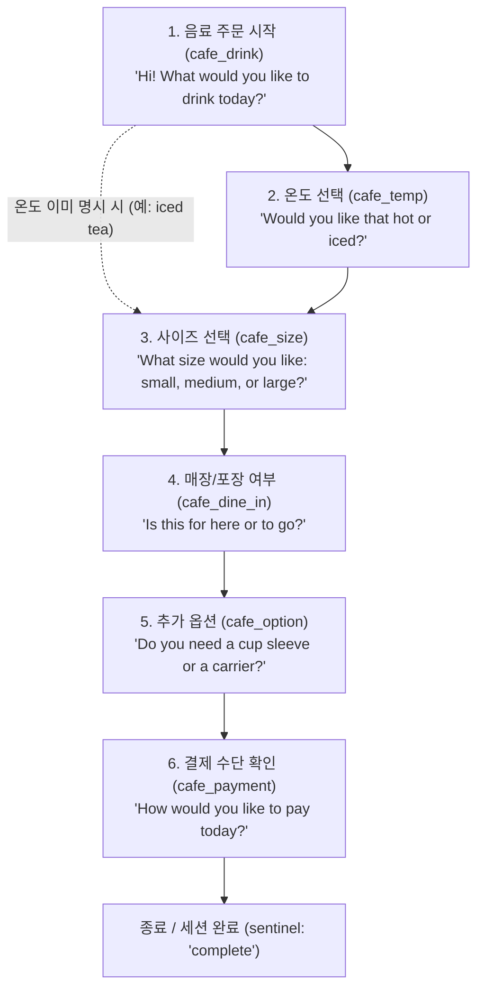

# FOLLOWUP-35: 무료 Gemini API 90% 한도 내 적응형 상황 회화 코치 조사 및 설계 검토서

> **문서 상태:** 조사 및 아키텍처 설계 검토서 (구현 승인 전 연구 단계).  
> **규칙 준수:** 제품 코드(`src/`, `functions/`, `tests/`), 패키지, Git, 배포 일체 미변경. 실제 앱/Google 개발자 API 추가 호출 0회 유지 (Gemini 구독 CLI 조사는 별도 서비스).  
> **구분 원칙:** 본 문서는 **확인된 사실(Fact)**, **계산 모델링을 위한 가정(Assumption)**, **아직 검증되지 않은 미검증 항목(Unverified)**을 엄격히 구분하여 기술합니다.

---

## 1. 개요 및 배경

사용자는 상용 서비스(예: OpenAI 2026-01-22 Praktika 사례: 실시간 STT + 맥락 이해 + 대화 계획 에이전트 + 장단기 학습 메모리)처럼, 고정된 5문항을 순서대로 읽는 단방향 방식을 넘어 **"학습자의 실제 답변과 맥락에 맞추어 유기적으로 후속 질문을 건네고, 답변의 의미를 이해하며 초보자 눈높이에서 교정"**하는 대화형 회화 구조를 검토하고자 합니다.

그러나 본 프로젝트는 다음의 **엄격한 불변 요건**을 전제로 합니다:
1. **무료 등급 90% 하드캡 보존:** 유료 종량제 API, 결제 연동, 신규 API 키 발급, 다계정 편법 우회가 전면 금지됩니다. Google AI Studio 콘솔의 무료 프로젝트 설정 한도(15 RPM / 250,000 TPM / 500 RPD) 대비 90% 정수 내림(floor) 상한인 **13 RPM / 225,000 로컬 보수 계량 유닛 TPM / 450 RPD**를 단 1회라도 초과해서는 안 됩니다.
2. **단일 호출 원칙 (에이전트 다중화 금지):** 유료 다중 에이전트 체인(전사 에이전트, 질문 생성 에이전트, 교정 에이전트 분리)을 도입하면 턴당 3~4회의 API가 소모되어 450 RPD 한도가 급속히 소진됩니다. 따라서 **"의미 평가 + 짧은 한국어 교정 + 영어 모범 예문 + 다음 상황 질문 ID 추천"**은 반드시 **1회의 단일 AI 호출**로 통합되어야 합니다.
3. **학습 루프 및 안전성 불변:**
   - 만 18세 이상 성인 확인 1회 후 로그인/계정 없이 즉시 사용.
   - 진행 안내 및 원포인트 조언은 한국어, 질문 및 모범 예문은 영어.
   - 학습자가 답변하면 AI가 평가하고, 완전하면 1회, 미완성이면 2회 소리 내어 반복 연습 후 사용자가 명시적으로 '다음' 버튼을 눌러야 다음 질문으로 전이.
   - AI가 정식 승인한 문장의 동일 반복만 로컬 정규화 재사용(API 0회) 처리하며, 단어/숫자/부정 의미 변경 시에는 반드시 재호출.
   - STT 엔진(현재 Web Speech API 기본, Whisper WASM은 별도 패널 대조군)과 텍스트 의미 이해는 명확히 분리. STT 오인식을 AI가 추측했다고 해서 "STT가 개선되었다"고 주장하지 않음.

---

## 2. 현재 구현 분석: 자연어 AI 평가 현황 vs 한계

### 2.1 현재 구현된 자연어 AI 평가 (`publicCoachHandler.ts`, `CoachTutorController.ts`)
- **의미 판정 (`meaning: 'relevant' | 'needs_help' | 'uncertain'`)**:
  - `relevant`: 문법적 잔실수나 단답이라도 질문 의도에 부합하면 인정 (예: 나이 질문에 "six", 카페 질문에 "Coffee, please"나 "I has coffee" 등 주어/동사 불일치도 relevant로 수용).
  - `sentenceComplete`: 완전한 문장 구조(주어+동사)를 갖추었는지 분리 판정.
  - **주의**: "Coffee, please."나 "I want coffee."는 실제 카페에서 널리 쓰이는 자연스럽고 완전한 표현입니다. 이를 "영어 문법 오류"로 단정해서는 안 되며, "주어와 동사를 갖춘 정중한 표현(`I would like an iced coffee, please.`)을 연습하는 수업 목표"임을 안내하는 방향이어야 합니다.
- **다중 음성 가설(Candidates) 문맥 선택**:
  - Web Speech API가 "couple"로 잘못 전사했더라도 후보군에 "coffee"가 있으면 문맥상 1번 인덱스를 채택하고, 탈락한 오인식 단어를 학습자 발음 탓으로 지적하지 않음.
- **가명 및 비영어 고유명사 보호**:
  - 한국어 이름 로마자 표기(Minjun 등)를 오류로 단정해 Alex 등으로 임의 치환하지 않음.
- **안전한 로컬 반복 재사용 (`normalizeRepeatAnswerKey`)**:
  - AI 승인을 받은 정답 문장에 대해 대소문자, 공백, 말미 종결부호(., !, ?) 차이만 허용하여 불필요한 upstream 호출을 0회로 절감.

### 2.2 고정 5문항 방식과 대화 맥락 부재의 한계
- **파일/함수 근거:**
  - `coachProtocol.ts`: `COACH_QUESTIONS` 상수가 `name -> age -> cafe -> breakfast -> hobby` 5개로 영구 고정되어 있음.
  - `CoachTutorView.tsx`: `handleNextQuestion`이 `questionIndex + 1`로 인덱스를 단순 증가시킴.
  - `publicCoachHandler.ts`: 요청 페이로드에 현재 `questionId`와 `answer`만 전달되며(`lines 306-315, 385-397`), 이전 턴의 학습자 답변 내용이나 문맥이 서버로 전달되지 않음.
- **실제 사용 경험의 단절:**
  - 사용자가 카페 질문에서 "I would like an iced americano, please."라고 구체적으로 답하더라도, 다음 질문은 뜬금없이 아침 식사나 취미로 이동하여 자연스러운 대화 흐름이 이어지지 않음.

---

## 3. 할당량 및 예산 계량 분석

### 3.1 공급자 한도 vs 로컬 90% 하드캡 정책
- **Google AI Studio 무료 프로젝트 콘솔 설정값**:
  - 15 RPM / 250,000 TPM / 500 RPD (이 한도는 Google AI Studio 프로젝트 설정에 따르며, 전역 불변 상수가 아님).
  - 동일한 Google 프로젝트를 공유하는 다른 앱/스크립트가 있다면 그 사용량까지 우리 앱의 D1이 통합 차단하지 못함.
- **우리 앱 D1 하드캡 (`MODEL_HARD_CAPS_90_PERCENT`)**:
  - **13 RPM / 225,000 로컬 보수 계량 유닛 TPM / 450 RPD**
  - **Caller RPM:** `min(실제 설정값, 13)` (사용자/환경이 더 작게 설정한 한도는 그대로 존중).
- **D1 원자적 예약/차감 정책**:
  - `450 RPD`는 "하루 450문항 완료"가 아니라 **"하루 최대 450개의 예산 예약/소모 평가 시도"**를 의미하며, 실제 제공사 요청 및 완료 문항 수와 다를 수 있습니다 (consume 후 fetch 전 취소 등도 예산 차감될 수 있음).
  - D1 원자적 예약(`reserve`) 및 차감(`consume`)은 upstream 호출 직전에 이루어지며, 네트워크 타임아웃이나 upstream 503 에러가 발생해도 환불되지 않음 (재시도 0회).
  - 로컬 TPM 유닛(16,384 + JSON 바이트)은 **"보수적 로컬 안전 예약 유닛"**이며, Google이 실제 집계하는 BPE 토큰 수와 다름. 이 값을 "실제 토큰 수"라 부르지 않음.

### 3.2 직렬화 페이로드와 로컬 예약 유닛 검증
- **모의 핸들러 실측값 (Codex 모의 검증)**:
  - 합성 입력 `I would like tea, please.` 요청 시: HTTP 200, mock upstream 1회, 로컬 예약 `units: 16,486`, 직렬화된 요청 페이로드 크기 3,314 바이트, `maxOutputTokens: 512`.
  - **미검증 사실**: 4바이트/토큰과 같은 단순 환산은 실제 BPE 토큰 수나 비용 상한을 수학적으로 증명하지 못함. 실제 Google BPE 토큰 수는 측정되지 않았으므로 "완벽한 안전 마진"이라 단정할 수 없음.
- **맥락 바이트 증가에 따른 로컬 TPM 예약 유닛 및 허용 호출율 (모델링 가정)**:
  - 예약 산식: `estimatedUnits = 16,384 + JSON_바이트수`
  - 추가 맥락 바이트 가설에 따른 호출당 예약 유닛과 분당 허용 호출 수 (`floor(225,000 / estimatedUnits)`):
    - 맥락 0 B 추가: 16,486 units -> 분당 최대 13회 호출 (13 RPM 상한에 도달)
    - 맥락 512 B 추가: 16,998 units -> 분당 최대 13회 호출
    - 맥락 1,024 B 추가: 17,510 units -> 분당 최대 12회 호출
    - 맥락 2,048 B 추가: 18,534 units -> 분당 최대 12회 호출
    - 맥락 4,096 B 추가: 20,582 units -> 분당 최대 10회 호출
  - **원칙**: 미래 확장 시에도 기존 `16,384` 기본 예약값을 임의로 삭감하지 않는 엄격한 계량 시험이 반드시 선행되어야 함.

### 3.3 세션 길이 및 일일/분당 수용량 모델링

총 외부 AI 호출 수 $C$는 다음과 같이 정의됩니다 (중복 계산 배제):
$$C = \sum (\text{질문별 최초 성공 시도}) + \sum (\text{달라진 발화/추가 평가 성공 시도}) + \sum (\text{실패한 외부 시도})$$

> **주의:** 아래 일일 완주 표는 타 프로젝트의 공유 사용량, 네트워크/upstream 실패, 기존 소모량이 전혀 없다는 가정하의 이론적 상한입니다.

| 시나리오 모델링 (가정) | 문항 수 | 세션당 총 API 호출 수 $C$ | 450 RPD 기준 일일 완주 가능 세션 수 |
| :--- | :---: | :---: | :---: |
| **모형 1: 10문항 전부 최초 정답** (반복은 로컬 재사용) | 10 | 10회 | **45 세션 / 일** |
| **모형 2: 10문항 전부 최초 단답 후 완전 문장 재평가** | 10 | 20회 | **22 세션 / 일** |
| **모형 3: 10문항 혼합** (5개 최초 정답 + 5개 단답 재평가) | 10 | 15회 | **30 세션 / 일** |
| **모형 4: 6문항 최초 정답** | 6 | 6회 | **75 세션 / 일** |
| **모형 5: 6문항 중 2개 단답 재평가 + 1회 발음 변경 재평가** | 6 | 9회 | **50 세션 / 일** |

- **동시 사용자 수용량의 수학적 한계**:
  - 동시 수용 가능한 사용자 수 $N$은 단순 인원수가 아니라, 각 사용자의 분당 호출 속도 $r_i$와 호출당 실제 예약 유닛 $E_i$에 의해 결정됩니다:
    $$\sum_{i=1}^{N} r_i \le 13 \quad \text{and} \quad \sum_{i=1}^{N} r_i \cdot E_i \le 225,000$$
  - 예: 사용자가 1분에 2회씩 발화/평가를 진행할 경우($r_i = 2$), 동시 사용자 6명의 호출 속도 합계는 12회/분(13 RPM 미만)이지만, 7명이 되면 14회/분으로 13 RPM을 초과합니다. 또한 모든 요청의 예약 유닛 합도 225,000을 넘을 수 없습니다.
  - 따라서 "동시 40~50명 완주 보장"과 같은 주장은 성립하지 않으며, 일일 450 RPD는 **하루 전체 누적 예산 평가 시도 상한**을 의미합니다.

---

## 4. 아키텍처 대안 비교

| 비교 항목 | 대안 1: 완전 자유 생성형 (Unconstrained Generation) | 대안 2: 서버 공인 카탈로그 + 유한 상태 전이 (권장안) | 대안 3: 클라이언트 규칙 분기 (No AI for Next Q) |
| :--- | :--- | :--- | :--- |
| **질문 생성 방식** | Gemini가 학습자 답변을 보고 임의로 영어 후속 질문 작문 | 서버에 정의된 시나리오 노드 그래프 내에서 Gemini가 적절한 `nextQuestionId` 선택 | 클라이언트가 정규식/단어로 분기하고 AI는 평가만 수행 |
| **장점** | 다양한 대화 흐름 가능 | **초보자 어휘/난이도 통제, 유효하지 않은 ID 차단, 서버 결정론적 검증 가능** | 구현 단순, 분기 비용 0원 |
| **한계 및 위험** | - 초보자 수준을 벗어난 고난도 어휘 출현 위험<br>- 교육 목표 통제 불가 | 구조화 JSON 및 화이트리스트가 허용된 ID만 보장할 뿐, 문맥 선택의 교육적 적절성까지 100% 보장하지는 못함 | 대화가 기계적이고 맥락 이해가 부족함 |
| **API 호출 수** | 턴당 1회 (평가+작문 통합) | **턴당 1회 (평가+ID선택 통합)** | 턴당 1회 (평가만) |
| **보안 검증** | 위험 (클라이언트/AI 임의 상태 전송) | **우수 (서버 화이트리스트 간선 검증)** | 양호 |
| **결론** | 비권장 | **권장 (유한 상태 전이 및 안전 통제)** | 보류 |

---

## 5. 권장 설계: "서버 공인 카탈로그 기반 유한 상태 전이"

### 5.1 카페 주문 시나리오 노드 및 일관된 간선 정의 (기본 6문항 / 온도 지정 시 5문항)

- 기본 경로는 `cafe_drink -> cafe_temp -> cafe_size -> cafe_dine_in -> cafe_option -> cafe_payment` 순서의 6개 질문으로 구성됩니다.
- 첫 질문에서 학습자가 이미 온도를 포함하여 답변한 경우(예: "An iced tea, please."), `cafe_temp`를 건너뛰고 곧바로 `cafe_size`로 이동하는 5문항 단축 경로가 허용됩니다.
- 마지막 결제(`cafe_payment`) 이후의 자체 종결 인사(Closing)는 질문이 아니므로 문항 수에서 제외합니다.



#### 유효한 노드 및 허용 간선 표 (`allowedNextQuestionIds`):
1. `cafe_drink`: `['cafe_temp', 'cafe_size']` (기본은 온도 확인, 온도가 이미 언급되었으면 사이즈로 직행)
2. `cafe_temp`: `['cafe_size']` (온도 지정 후 사이즈로 이동)
3. `cafe_size`: `['cafe_dine_in']` (사이즈 선택 후 매장/포장 여부 확인)
4. `cafe_dine_in`: `['cafe_option']` (포장 여부 확인 후 슬리브/캐리어 필요 여부 확인)
5. `cafe_option`: `['cafe_payment']` (옵션 확인 후 결제 수단 질문으로 이동)
6. `cafe_payment`: `['complete']` (마지막 노드로 서버 정의 완료 sentinel인 `'complete'`만 허용)

#### 턴별 대화 예시 (단축 5문항 경로 가정):
- **Turn 1 (`cafe_drink`):** 점원 *"Hi! What would you like to drink today?"*  
  -> 학습자: *"I would like an iced tea, please."*  
  -> AI 평가: `meaning: 'relevant', sentenceComplete: true`.  
  -> AI 추천: `nextQuestionId: 'cafe_size'` (학습자가 이미 iced를 언급했으므로 허용 간선 중 `cafe_size` 선택).  
  -> 1회 소리 내어 반복 연습 후 학습자가 '다음' 버튼 클릭 시 `cafe_size` 질문으로 전이.

### 5.2 서버 단일 호출 JSON 스키마 및 보안 검증
- **클라이언트 입력 불신 및 400 차단 원칙**:
  - 클라이언트가 전달한 `scenarioId`, `currentQuestionId`가 서버의 공인 카탈로그에 부합하지 않거나, `historySummary`의 서식/ID/길이(UTF-8 최대 1,024B, 본문 전체 4KiB)가 한도를 벗어나면 **D1 예산 차감 전에 HTTP 400으로 즉시 거절**합니다.
  - 서버는 클라이언트 히스토리의 서식, ID, 길이를 검증할 수 있지만 과거 답변의 실제 사실성 자체를 증명할 수는 없으므로 불신 데이터로 처리합니다.
  - 조작된 ID를 `defaultNextId`로 자동 승격하여 통과시키는 위험한 폴백을 제거합니다.
  - 입력 후보 인덱스 범위 및 원본 후보 실존 검증을 엄격히 유지하며, 모범 예문(`modelAnswerEn`)을 정답 캐시로 자동 등록하지 않습니다.
- **AI의 잘못된 추천 ID 및 세션 종료 처리**:
  - Gemini가 현재 노드의 `allowedNextQuestionIds`에 없는 ID를 반환할 경우, 이는 이미 API 1회를 소모한 상태입니다. 시스템은 이를 유효한 전이로 인정하지 않으며, **검증 오류로 처리하고 현재 단계를 유지**합니다 (임의의 노드로 자동 전이하거나 자동 재시도하지 않음).
  - 마지막 노드(`cafe_payment`)에서는 `nextQuestionId: 'complete'`(서버 정의 완료 sentinel)만 허용되며, 다른 노드에서 조기에 `'complete'`를 반환하는 조기 종료는 거부됩니다.
- **AI 프롬프트에 허용 후보 메타데이터 공급 (최대 3개)**:
  - Gemini에게 단순 ID 문자열만 보내면 선택할 수 없으므로, 서버가 현재 노드에서 허용된 후보(최대 3개)의 `id`, `questionEn`, `selectionCriterion`(선택 기준)을 함께 주입합니다.
  - 클라이언트가 임의로 만든 질문이나 간선 정보는 절대 신뢰하지 않고 서버 카탈로그에서만 주입합니다.
- **단일 호출 요청 구조 (`geminiUserContent`)**:
```json
{
  "scenarioId": "cafe_order_v1",
  "currentQuestion": {
    "id": "cafe_drink",
    "questionEn": "Hi! What would you like to drink today?",
    "objectiveKo": "원하는 음료 메뉴를 정중하게 주문한다."
  },
  "userAnswerEn": "I would like iced tea, please.",
  "inputSource": "voice",
  "recentContext": {
    "turnNumber": 1,
    "lastUnderstoodConcept": "iced tea"
  },
  "allowedNextCandidates": [
    {
      "id": "cafe_temp",
      "questionEn": "Would you like that hot or iced?",
      "selectionCriterion": "음료의 온도가 아직 지정되지 않은 경우"
    },
    {
      "id": "cafe_size",
      "questionEn": "What size would you like: small, medium, or large?",
      "selectionCriterion": "학습자가 이미 음료의 온도를 명시한 경우"
    }
  ]
}
```
- **Gemini 응답 스키마 (`responseSchema`)**:
```json
{
  "type": "object",
  "properties": {
    "recognizedCandidateIndex": { "type": "integer" },
    "meaning": { "type": "string", "enum": ["relevant", "needs_help", "uncertain"] },
    "sentenceComplete": { "type": "boolean" },
    "feedbackKo": { "type": "string" },
    "modelAnswerEn": { "type": "string" },
    "nextQuestionId": { "type": "string" }
  },
  "required": [
    "recognizedCandidateIndex",
    "meaning",
    "sentenceComplete",
    "feedbackKo",
    "modelAnswerEn",
    "nextQuestionId"
  ]
}
```

### 5.3 세션 상태 전이 및 로컬 캐시 수명주기
1. **Pending 전이 보관**:
   - Gemini가 제안한 `nextQuestionId`는 컨트롤러의 `pendingNextQuestionId`에 임시 보관됩니다.
   - 현재 질문에 대한 반복 연습(완전 1회, 미완성 2회)이 완료되기 전에는 절대 다음 질문으로 전이되지 않습니다.
   - 반복 중 발화가 달라져 재평가를 받으면 최신의 유효한 `nextQuestionId`로 갱신됩니다.
   - `meaning === 'uncertain'`이거나 평가 실패 시에는 전이를 금지하고 현재 단계에 머무릅니다.
2. **세션 메모리 바운딩 및 클라이언트 히스토리 불신**:
   - 전체 본문 크기(4 KiB) 및 JSON 직렬화 한도(최대 1,024 바이트)를 준수하기 위해, 최근 2턴 이내의 맥락만 유지합니다.
   - 용량 초과 시 오래된 턴을 통째로 drop하며, 학습자의 실제 답변 텍스트를 임의로 글자 단위로 잘라 변형하지 않습니다.
   - 서버는 전달된 히스토리의 서식, ID, 길이를 검증할 수 있지만 과거 사실성 자체를 증명할 수는 없으므로 불신 데이터로 격리 취급합니다.
3. **캐시 키 무결성 및 세션 격리**:
   - 안전 정규화 재사용 키: `scenarioId + ':' + nodeId + ':' + objectiveVersion + ':' + normalizeRepeatAnswerKey(text)`
   - 캐시는 현재 질문 인스턴스 및 맥락 버전에 엄격히 한정되며, 사용자가 새 질문 인스턴스로 전이하거나 시나리오를 변경/초기화하면 이전 캐시는 즉시 초기화(reset)됩니다.

---

## 6. 무료 한도 고갈 시의 동작 정책

1. **미승인 발화의 정답 승격 금지**:
   - 일일 450 RPD가 소진되거나 분당 13 RPM 차단 대기 상태일 때, 학습자의 새로운 발화를 AI가 평가한 것처럼 가장하여 성공 처리하는 것을 엄격히 금지합니다.
2. **채점 없는 모범 예문 듣기/따라하기 복습 모드**:
   - 한도 도달 시 생성되었던 모범 예문(`modelAnswerEn`)을 다시 듣고 따라 말해보는 것은 **채점과 평가가 없는 단순 예문 복습**으로만 제공됩니다 (이 모범 예문 자체가 AI 승인을 받은 학습자 발화인 것처럼 정답 캐시로 등록될 수 없음).
   - 0호출 안전 정규화 정답 판정은 **학습자가 실제로 말하여 `meaning === 'relevant'` 및 `sentenceComplete === true`로 AI 승인을 받은 문장**에 한해, 현재 질문 인스턴스 및 맥락 범위 내에서만 허용됩니다 (후보군 복구로 채택된 경우는 제외).
   - 새로운 질문 인스턴스로의 전이나 한도 소진 중 발생한 미평가 발화에 대한 성공 승격은 금지되며, 새로운 AI 평가는 한도가 복구될 때까지 중단됩니다.

---

## 7. 향후 검증 절차 및 단계별 로드맵

1. **미검증 항목 (Unverified)**:
   - 본 제안서는 아키텍처 검토 단계이며, 실제 적응형 대화 흐름의 응답 속도, 초보자 발음 교정 효과, 분기 자연스러움은 아직 실측되지 않았습니다.
2. **필요한 사전 검증 절차**:
   - `tests/conversationPublicCoach.test.ts`: 모의 핸들러 환경에서 카탈로그 간선 검증 및 `nextQuestionId` 화이트리스트 필터링 단위 테스트.
   - D1 SQLite 예산 계량 시뮬레이션: 기본 16,384 예약 유지 및 추가 맥락 전체 계량, 각종 한도 초과 차단 검증.
3. **단계별 구현 로드맵 권장**:
   - 한 번에 여러 시나리오를 동시에 도입하지 않고, **카페 주문 1개 시나리오(기본 6문항 / 단축 5문항)**를 대상으로 단계적으로 접근합니다.
   - 구현 시 수정 대상 파일 수를 인위적으로 3개로 제한하지 않으며, 필요에 따라 `coachProtocol.ts`, `publicCoachHandler.ts`, `CoachTutorView.tsx` 외에도 `publicCoachApi.ts`(요청/응답 인터페이스 확장), `CoachTutorController.ts`(pending 전이 및 캐시 수명주기 관리) 등 관련 접점을 포괄하여 정밀하게 구현 및 검증합니다.

---

## 8. 사실/가정/미검증 구분 요약

- **확인된 사실 (Fact)**:
  - 현재 `publicCoachHandler.ts`는 `gemini-3.5-flash-lite` 단일 호출을 사용하며, D1 하드캡(13 RPM / 225,000 유닛 / 450 RPD)을 엄격히 적용 중임.
  - 현재 코칭 질문은 `COACH_QUESTIONS` 5개로 정적 고정되어 있으며 이전 대화 맥락이 전달되지 않음.
  - 모의 핸들러 실측 직렬화 요청 크기는 3,314 바이트이며, `estimatedUnits`는 16,486 유닛임.
- **모델링을 위한 가정 (Assumption)**:
  - 위 3.3의 세션당 9회 등 수치 모델링은 특정 오답/재시도를 전제로 한 가상의 계산 예시이며, 실제 학습자의 발화 오류, 네트워크 실패, 변형 재시도 횟수에 따라 호출 수는 변동될 수 있음.
  - 분당 동시 수용량은 사용자의 분당 발화 속도와 요청 크기에 의해 수학적으로 제한되며, 특정 인원수의 동시 완주가 보장되지 않음.
- **미검증 항목 (Unverified)**:
  - 실제 Google BPE 토큰 수 및 청구 한도 상한.
  - 실제 초보자 단말 환경에서의 적응형 대화 교육 효과 및 체감 지연 시간.
  - Gemini가 제공된 화이트리스트 간선 내에서 항상 교육적으로 가장 적절한 질문 ID를 선택하는지의 정확도.
