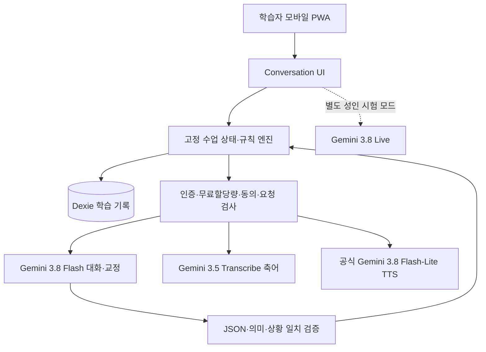

# 보카 스터디 — 구글 무료 Gemini 기반 AI 회화 학습 시스템 통합 개발 계획서 v2.2

> **작성·검토일:** 2026-10-21 (KST) · 16:34 기준 재확인  
> **상태:** 회화 기능 + 알고리즘 보드 동기화 통합 설계 기준 · **사용자는 2026-10-21 로컬 개발 실행 지시서 발급을 요청함**. 로컬 구현·모의 시험은 별도 지시서 범위에서 진행 가능하나, **유료 호출·운영 배포·실서비스 DB 변경·삭제·커밋·푸시는 미승인**.  
> **대상 앱:** 보카 스터디(Voca Study), `https://github.com/kcgbck/voca-study`  
> **검토 기준:** GitHub `main` 커밋 `8248697cb4702719dfe7191195bccba5851a9cd4` 정적 소스 검토. **로컬 앱 실행·구글 계정별 호출 시험·실기기 시험은 수행하지 않음.**  
> **기준 문서:** 사용자가 제공한 「AI 회화 학습 기능 개발 기획 및 아키텍처 설계서」와 알고리즘 보드 원본 HTML/MD. 의도와 목표를 유지하고, 실제 코드·검증 근거에 따라 정합성을 보완한다.

## 0. 최종 결론 — 지금 결정할 한 가지 방향

**기존 보카 스터디의 외관·설정·내비게이션·PWA·저장 구조는 최대한 재사용하고, 별도 `conversation` 학습 모듈을 추가한다. 대화·교정의 핵심은 구글 Gemini 무료 등급(`gemini-3.8-flash`)으로 구성한다. 음성 입력은 `gemini-3.5-transcribe`(축어 전사), 음성 출력은 공식 `gemini-3.8-flash-lite-tts`를 우선 검증한다. 음성 자유대화가 안정화되면 `gemini-3.8-live`를 별도 모드로 확장한다.**

이때 프로그램의 본질은 **무제한 자유 대화 챗봇이 아니라 '체계적으로 말하기 능력을 개선하는 회화 학교'**여야 한다. 4단계의 실제 수업 목표, 예습, 모델 듣기, 짧은 대화, 스스로 수정, 전이 과제, 복습, 단원 평가가 한 흐름으로 이어져야 한다.

**배포에 앞선 필수 관문:** 구글 Gemini API 무료 등급의 **서비스 이용 약관**과 기존 앱의 **보안·백업 문제**를 해결한다. 구글 약관은 18세 미만이 접근할 가능성이 있는 클라이언트에서 사용을 제한하고 개발 목적·소비자 이용에 제약을 명시한다. 따라서 **전체 공개 소비자용 PWA에 곧장 붙여 배포한다고 확정할 수 없다.** 승인된 개발·내부 시험부터 진행한다. 사용자 개인정보·학습 기록은 무단 전송하지 않는다.

### 운영상의 고정 제약

1. **구글 API 선택은 옵션 2로 확정**한다. Cloudflare Workers AI/로컬 LLM로 기본 엔진을 바꾸거나 자동 전환하지 않는다.
2. **유료 종량제 API 호출 금지**. 구글 프로젝트는 무료 등급 확인, 유료 청구 연결·승급 경로 비활성 확인, Cloudflare 무료 리소스 한도 확인. 한도 소진 시 요청 중단 및 오프라인 대본 학습 제공(별도 AI로 몰래 전환 금지).
3. 이 문서 단독으로는 실행 지시가 아니다. 다만 사용자가 추가 요청한 **`보카스터디_AI회화_통합개발_1차지시서_v2.1.md`**는 **로컬 코드 구현·모의 검증만** 명시적으로 지시한다. 운영 배포, 실서비스 DB 갱신·삭제, 유료 API, Git 커밋·푸시는 별도 승인 전 금지.
4. 기존 퀴즈·일본어·해사영어·사용자 문제집·학습 이력·랭킹에 영향 금지. 변경 전 스냅샷과 회귀시험 필수.
5. 무료 등급 사용 시 구글에 **전송된 입력·출력이 제품 개선 및 사람 검토에 사용될 가능성**이 있다. 전송 동의·비식별화·아동 차단·개인정보 입력 경고 필요. 기존의 사진·PDF·학습 기록 전체 업로드 금지 원칙 유지.
6. 콘텐츠와 평가가 정확하다고 AI가 자가 선언해도 통과로 인정하지 않는다. **교육용 골든셋 + 독립 검토**로 판정한다.

---

## 1. 원안 해부 — 유지할 것과 폐기할 것

| 원안 항목 | 판정 | 보강·수정 이유 |
|---|---|---|
| 입문/초급/중급/고급 4단계 | **유지** | 사용자 중심 UI 4단계. 단, 공식 CEFR 등급인 것처럼 표시하지 않는다. |
| 상황 제시 → 사용자 음성/문자 답변 → 교정·추가 대화 | **유지·강화** | 좋은 상호작용 방식이나 수업 목표·진도·자기수정·전이 단계 필요. |
| 'six' 또는 'good'은 교정 대상 | **교체** | 문맥상 자연스럽게 허용되는 단답도 있다. 오류, 선택적 확장, 불명확한 인식 구별. |
| AI가 수업 순서와 진행을 모두 임의 결정 | **교체** | 교육과정·기준 답변·시나리오 핵심 사실은 고정 자료와 규칙 엔진이 관리. |
| 4수준 × 5개 시나리오 = 20개 | **부족** | 정규 수업·반복·평가 부재. 4수준 × 8단원 × 4과 = 128과 구조로 확대. |
| Gemini 1.5 / Gemini 2.0 Flash | **폐기** | 모델 최신성 상실·2.0 Flash 종료. 3.8 Flash 등 현행 공식 모델로 교체. |
| Gemini 15RPM·1,500RPD 무조건 보장 | **폐기** | 한도는 프로젝트/모델/등급별 동적으로 적용. 실제 AI Studio의 프로젝트별 값이 기준. |
| Workers AI가 1순위 | **폐기** | 사용자는 Google 무료 API를 선택함. 기본엔진 교체 없이 해당 기준 준수. |
| 현재 앱 STT·TTS가 모두 준비되어 있음 | **수정** | 실제 `speechService.ts`에는 읽어주기(TTS)는 있으나 회화 STT 서비스 구현이 없음. |
| 고음질 TTS를 무조건 무료·정상 작동한다고 단정 | **폐기** | 현재 음성 프록시는 비공식 Google 번역 음성 URL에 의존. 공식 서비스 지속성 보장 없음. |
| 교정문 자동 복습노트 | **유지·분리** | 기존 단어 오답노트와 회화 성취·복습은 다른 데이터. |
| 구현 가능 '100%' | **수정** | 기술 구조 자체는 가능하나 프로젝트 한도·약관·실사용 성능·음성 인식률은 실검증 필요. |
| 4개 상단 탭으로 UI 변경 | **보류** | 실제 최신 소스의 상단은 `홈 / 영어 / 일본어` 세 개. 현행 내비게이션 보존이 우선. |

---

## 2. 실제 기존 앱 감사 결과: 재사용 가능한 '껍데기'인가?

### 2.1 확인된 현재 구조 — 사실

- **저장소 기준:** `kcgbck/voca-study` `main` SHA `8248697cb4702719dfe7191195bccba5851a9cd4`.
- **프런트엔드:** React 18, TypeScript, Vite. 설치형 PWA 및 반응형 CSS.
- **서버:** Cloudflare Pages Functions. 실제 서버 엔트리 `functions/api/[[route]].ts`(724줄, 확인 당시); 별도 구형 `src/worker.ts`도 남아 있음.
- **로컬 DB:** Dexie/IndexedDB `src/storage/db.ts`로 스키마 1·2 존재. 현재 회화 학습용 테이블 없음.
- **홈 메뉴:** `src/app/App.tsx` 내 실제 메뉴는 TOEIC, 해사영어, 해사통신, 일본어, 내가 만드는 문제집, 오답노트의 6개.
- **상단 메인 탐색:** 실제 코드는 홈/영어/일본어 **3개 버튼**. `PROJECT_STATUS.md` 설명 일부와 불일치. 코드 우선.
- **내비게이션:** `ActiveTab` 타입과 `navigateToTab`, 브라우저 `pushState/replaceState/popstate` 사용. 기능 추가에 타입·화면 분기 업데이트가 필요.
- **음성:** `src/services/speechService.ts`는 브라우저 `speechSynthesis` 및 오디오 프록시로 **TTS** 제공. `SpeechRecognition`은 해당 서비스에서 확인되지 않음. 회화 STT 새 구현 필요.
- **기존 TTS 위험:** `functions/api/[[route]].ts`의 `/api/tts`가 문서화된 Google Cloud TTS가 아닌 `translate.google.com/translate_tts?...client=tw-ob` 호출. 비공식 연동이므로 무료·가용성·약관 준수 보장을 하지 않는다. 기존 기능 함부로 제거하지 않고 별도 공식 어댑터 구축·검증 뒤 변경 검토.
- **테스트 분리 문제:** `tests/workerApi.test.ts`는 `src/worker.ts`를 테스트. 실제 운영 Pages Functions와의 일치성은 별도 통합시험 필요.
- **백업 결함:** `src/storage/backupService.ts`의 현행 백업 포맷 v1은 주로 단어장·단어·단어 통계·학습기록·앱 설정만 처리. DB v2 문제집 관련 여러 테이블이 백업 목록에서 제외됨. 회화 전용 데이터만 추가하는 방식으로는 완전 백업이 되지 않는다.
- **중요 보안 관찰:** `/api/admin/cleanup` 분기에 코드상 인증·메서드 가드가 보이지 않고 `performDatabaseCleanup`이 실제 `users` 자료 삭제를 실행한다. **정적 분석상의 고위험 관찰이며 실서비스 호출/악용 시험은 하지 않았다.** 공개 API를 확장하기 전 별도 안전 점검 및 인증 차단 필수.
- **서비스 워커:** `public/sw.js` v6는 `/api/*` 요청을 캐시하지 않는 구조. 온라인 AI/오프라인 정적 수업 분리와 맞음.

### 2.2 구조 완성도 판정

| 영역 | 판정 | 후속 조치 |
|---|---|---|
| 기존 화면 틀/버튼/설정/테마/PWA | **재사용 가능** | 기존 컴포넌트와 CSS 토큰·화면 폭 이용. |
| 로컬 저장 및 데이터 마이그레이션 기반 | **기반 존재** | 스키마 v3로 추가; 기존 테이블 무손실 유지. |
| 음성 출력 | **부분 재사용** | 정식 무료 TTS 어댑터를 신규 추가; 기존 비공식 프록시 분리. |
| 음성 입력 | **신규 개발** | 기기 권한·녹음·전사·불확실성 처리. |
| 수업 콘텐츠와 모듈 등록 체계 | **없음** | 레벨/단원/차시 데이터+FeatureRegistry. |
| 회화 세션·성취·복습 | **없음** | 독립 도메인/저장소 필요. |
| 서버 라우트 확장·인증·할당량 | **구조보완 필수** | Gemini 전용 서버 엔드포인트·최소 권한·제한 장치. |
| '파일만 하나 넣으면 새 기능 추가' | **현재는 아님** | 최소 기능 레지스트리와 공통 앱 셸 분리. |

**개발 결정:** 기존 앱 전면 재개발, 프레임워크 교체, 대규모 리팩터링 불필요. 다만 기능 추가가 쉬운 '슬롯'을 최소한으로 만들고, 그 슬롯 안에 회화 기능을 **독립된 학습 서브시스템**으로 넣는다. 향후 영어→일본어 회화 확장도 같은 틀과 콘텐츠/언어 어댑터 변경으로 처리하되, 이번 범위에서는 일본어 회화 실제 구현을 하지 않는다.

### 2.3 아키텍처 개선의 객관적 합격 조건

1. 다음 학습 기능 추가 시 `App.tsx` 전체를 복사하거나 거대한 `QuizPreviewView.tsx`를 수정하지 않는다.
2. 홈 카드/탭/아이콘/경로/로딩 컴포넌트 등록은 **한 곳**에 선언하여 진입 및 뒤로가기가 일관되게 작동한다.
3. 각 학습 도메인은 컴포넌트·데이터·엔진·테스트를 자기 폴더에 보유한다.
4. **동일 기능의 신규 단원 추가**는 단원 JSON(검증된 스키마)만 추가하면 가능해야 한다. 앱 껍데기 코드를 수정하지 않는다.
5. 새 모듈 등록/삭제가 기존 TOEIC·해사영어·일본어·문제집 데이터/랭킹에 영향을 주지 않는다.
6. 기존 시험과 함께 신규 기능 경로를 실제 Pages Functions 통합시험으로 검증한다.

---

## 3. 구글 무료 모델 선정 — 2026-10-21 공식 문서 기준

| 사용처 | 구글 모델 식별자 | 무료 제공 여부(공식 가격표의 Standard) | 설계상 선택 |
|---|---|---|---|
| 정규 수업의 대화 이해·핵심 교정·수업 질문 | `gemini-3.8-flash` | 무료 입력·출력 표시 | **기본 주력** |
| 짧은 보조 번역 등 정형 작업 | `gemini-3.5-flash-lite` | 무료 입력·출력 표시 | 선택적; 호출 횟수 절감이 먼저 |
| 영어 음성 → 축어 텍스트 | `gemini-3.5-transcribe` | 무료 입력·출력 표시 | 음성 입력 정밀 모드 |
| 읽어주기/모범 발음 생성 | `gemini-3.8-flash-lite-tts` | 무료 입력·출력 표시 | 공식 고품질 TTS 1차 검증 |
| 중요한 예문의 음색 품질 비교 | `gemini-3.8-flash-tts` | 무료 입력·출력 표시 | 음성 품질 비교 시험 |
| 자연스러운 실시간 쌍방향 음성 | `gemini-3.8-live` | 무료 입력·출력 표시 | **정밀수업과 별도 '실전 자유회화' 모드** |
| 복잡한 고급 추론 | `gemini-4-argon` | 무료 티어 미지원 | **사용 금지** |

**주의**: 위 '무료'는 **공식 가격표에 무료 등급이 표기된다는 뜻**이지, 해당 Google 프로젝트에서 모든 모델이 활성화·모든 분당 요청 수 보장·무제한 사용·공개 서비스 허용이라는 뜻은 아니다. 프로젝트별 실사용 한도는 Google AI Studio에서 확인하며, API 키로 소규모 실사용 시험을 통과한 경우에만 그 기능을 켠다. 과금 연결이 필요한 모델/기능은 추가하지 않는다.

### 3.1 실사용 모드 분리 — 성능과 교육 목적을 모두 잡는 방식

**A. 정밀 수업 모드(기본):** 사용자가 음성 또는 문자로 답변 → (음성일 경우) `gemini-3.5-transcribe`의 **verbatim(축어)** 모드 → 사용자 확인/정정 가능한 전사 → `gemini-3.8-flash`가 원포인트 피드백 + 수업 다음 행동을 **구조화된 JSON**으로 출력 → 앱이 기준과 대조하여 화면/음성 표시 → 필요 시 공식 TTS. 목표 달성·기록은 앱 규칙 엔진에서 확정한다.

**B. 실전 자유회화(추가):** `gemini-3.8-live`로 사람처럼 음성 주고받기, 끼어들기·응답 흐름 중심. 실시간 대화를 무리하게 JSON 채점으로 통제하지 않는다. **Live는 구조화된 출력 기능을 지원하지 않는다**고 모델 문서에 명시됨. 세션 종료 후 요약 전사를 별도 `gemini-3.8-flash`에 보내는 경우 동의·무료 한도 확인 후 학습 피드백 생성. 수업 합격 판정에는 쓰지 않는다.

**C. 제한·실패 모드:** 무료 할당량/네트워크 부족 시 **기존에 저장한 교재**, 질문 문장, 선택지 힌트, 녹음 없이 따라 읽기, 누적 복습카드는 오프라인에서도 제공한다. **'AI 응답'을 오프라인에서 만들었다는 허위 표기 금지.** STT/TTS 불가 시 텍스트 모드 유지.

### 3.2 음성 인식에서 놓치면 안 될 원리

- Gemini 3.5 Transcribe에는 `verbatim`과 `smart`가 있다. 회화 교정은 말실수·반복·머뭇거림이 관찰 대상이므로 **`verbatim` 고정**. `smart`는 말을 정돈하고 문법까지 정리할 수 있어 학습자의 원래 발화를 왜곡한다.
- 전사는 발화를 추정한 결과일 뿐 100% 진실이 아니다. 오류/낮은 신뢰·애매한 이름/숫자/부정문은 '내가 이렇게 말한 게 맞나요?'라는 확인 UI를 제공한다.
- 브라우저 음성 인식(Web Speech Recognition)은 플랫폼·브라우저 차이가 있고 브라우저 구현에 따라 외부 음성처리 서비스가 사용될 수 있으므로 **명시적인 동의 및 지원 확인이 필요한 대체 옵션**이지 모든 휴대폰에 보장된 오프라인 엔진이 아니다.
- 모델 TTS 음성은 표준 발음 예시이며 이것으로 학습자 발음 점수의 객관성을 주장할 수 없다. **STT 정확도=발음 정확도 아님**.
- 음성·텍스트 원문이 Google 무료 API에 전달되는 내용은 Google 측에서 사용될 수 있으므로 동의·민감정보 전송 경고를 반복해서 명확히 한다.

### 3.3 무료 호출 수량 최적화

**설계 제안(실제 한도는 미확인):**

1. *텍스트 턴 1회당 AI 1호출*: 의미 평가, 핵심 교정 1개, 자연스러운 반응, 다음 질문, 힌트 1~2개를 단일 JSON으로 수신한다.
2. 최근 대화 **핵심 상태 요약 + 필요한 마지막 대화 몇 턴**만 전송. 통째로 1,000개 대화 누적 전송하지 않는다. 요약도 로컬에서 최소화.
3. TTS는 수업 고정 표현·사용자가 명시적으로 요청한 예문 우선. 이전에 같은 공개 예문을 생성했다면 캐시 가능한 콘텐츠만 저장하고 민감한 사용자 발화는 캐시하지 않는다.
4. 진도/오답 카운트/힌트 공개/복습 시점은 앱에서 계산. AI 호출 낭비 방지.
5. 일정 시간/사용자 세션/일일 소프트 제한을 측정한 뒤 적정 값 확정. 미승인 호출 무한 재시도 금지.
6. 구글 무료 한도 도달 429는 서버에서 그대로 식별, 사용자에게 잔여 추정치가 아닌 **'현재 사용 제한으로 AI 대화를 일시 중단'** 표시. 필요 시 다음날 재시도.
7. Google Cloud 과금/프로젝트 사용량은 사람이 확인해야 하므로 **계정 수준 실제 무료 쿼터가 확인되기 전 대규모 배포 금지**.

### 3.4 약관·서비스 공개 관문 — 개발 차단 가능 요소

공식 2026-03-23 효력 약관에는 **18세 이상 사용**과 **18세 미만이 접근할 가능성이 있는 앱에서의 API 사용 금지**, 그리고 개발자 전문/사업 목적의 사용과 소비자 이용 제한에 대한 문구가 존재한다. 무료 서비스는 제출한 내용·출력을 제품 개선에 사용하며 사람 검토 가능성을 공지한다. **따라서 현재 일반 사용자가 접근할 수 있는 `pages.dev`에 회화 기능을 자동 노출하지 않는다.**

배포 전 적합한 이용 범위와 허용 지역·대상 연령·개인정보 정책을 구글 공식 약관과 비교·검토한다. 불확실하면 **구글 약관에 적합하다고 확인된 성인 개발·내부 시험**으로만 범위를 제한하고, 개인의 소비자용 이용까지 허용된다는 식의 해석을 하지 않는다. 공개 전환은 중단한다. **약관을 우회하거나 제3자 계정 키를 공유하는 설계는 채택하지 않는다.**

---

## 4. 진짜 회화 교육과정 — 4단계, 32단원, 128차시

### 4.1 수준 정의

| 앱 단계 | 참고 범위(공식 시험 등급 아님) | 학습자가 실제로 할 수 있어야 할 일 | 주 발화 과제 |
|---|---|---|---|
| 입문 | Pre-A1~A1 참조 | 인사·자기소개·취향·짧은 요청에 적절히 응답 | 한 단어 → 필수 표현/1문장으로 확장, 듣고 따라하기 |
| 초급 | A1~A2 참조 | 여행·주문·길 찾기·결제 등 짧은 상황 해결 | 2~4개 턴의 상황 대화, 요청·확인·수정 |
| 중급 | B1~B2 참조 | 경험·이유·계획·의견을 연결해 설명 | 의견+근거, 상황 문제 해결, 30~90초 설명 |
| 고급 | C1~C2 참조 | 상대·상황에 맞게 설득·협상·쟁점 정리 | 다단계 토론, 미묘한 어조, 논리적 반론·조율 |

이 범위는 **사용자 친화적인 참고 매핑**이며 AI 자체 검사만으로 CEFR 공인 수준을 인증하지 않는다. 입문이라고 모든 문장을 '완전한 문장'으로만 말해야 하는 것이 아니다. 실제 현장에서 짧고 정확한 답이 자연스러울 수 있다.

### 4.2 각 단원 4차시 표준 구성 — 반복 가능한 교육 프레임

**1과 — 표현 인지:** 소리로 듣기, 뜻 추측, 핵심 표현 3~5개, 쉬운 예문, 속도 조절, 한글 번역은 선택.  
**2과 — 통제된 발화:** 문장 틀 바꾸기, 응답 선택 후 직접 말하기, 실수 시 힌트 3단계, 1개 핵심 오류만 수정.  
**3과 — 상황극:** AI 역할을 고정하고 4~8회(단계별 조절) 주고받기, 관련 추가 질문, 중간 대화 정합성 유지.  
**4과 — 전이·확인:** 대본/힌트 없이 **새로운 변형 상황**에서 스스로 표현. 성취 기준과 미달 학습 목표를 구별하여 다음 복습으로 연결.

1회 수업의 시간은 **기본값 8~12분**으로 설계하되 강제 타이머가 아니며 사용자와 실기기 시험 결과에 따라 조정한다. 길어질 경우 이어하기/중단하기를 제공한다.

### 4.3 단원 전체 편성(8단원 × 각 4과 = 단계별 32과)

| 순번 | 입문 | 초급 | 중급 | 고급 |
|---|---|---|---|---|
| 1 | 인사·첫 만남 | 카페·식당 주문 | 과거 경험과 사건 설명 | 발표·설명 구조화 |
| 2 | 이름·출신·나이 | 길 찾기·교통편 | 계획·예정 변경 설명 | 주장·설득·논증 |
| 3 | 기분·상태 표현 | 공항·호텔 체크인 | 선호·선택과 비교 | 협상·양보·조건 제시 |
| 4 | 음식·취미·좋아하는 것 | 쇼핑·교환·환불 | 의견과 이유·근거 | 면접·심화 질문 답변 |
| 5 | 가족·직업·사물 묘사 | 약속·날짜·시간 조율 | 고장·민원·문제 해결 | 갈등 조정·외교적 거절 |
| 6 | 일상 활동·빈도 | 전화·메시지·요청 | 업무 공유·회의·협업 | 가정·위험·불확실성 |
| 7 | 예/아니오·의문사 질문 | 길 잃음·긴급 도움 요청 | 동의·반대·대안 제시 | 격식·문화 맥락에 따른 표현 |
| 8 | 되묻기·도움 요청·종합 | 여행 종합 실전 | 장문 의견·종합 대화 | 사회·기술 주제 심층 토론 |

**총 128과**: 4레벨 × 8단원 × 4과. 한 단원에는 하나의 핵심 상황 뿐 아니라 **성취 목표·필수 표현·예시·대체 표현·금지 오개념·평가 기준·복습 태그**가 있어야 정규 수업이다.

**초기 실사용 범위:** 4단계 × 처음 2개 단원 × 4과 = **32과를 실제 검수 완료**해 출시 게이트를 열고, 나머지 96과는 같은 구조로 추가·교육 검토해 최종 128과로 완성한다. **32과만 만들고 128과 완료라고 보고하지 않는다.** 전체 최종 목표 128과는 변경하지 않는다.

### 4.4 샘플 수업 A: 입문 — 처음 만나는 사람

- **핵심 목표:** 인사와 이름/취향을 두 차례 이상 상호 교환한다.
- **핵심 문장:** “Hi, I'm Alex.” / “I'm from Korea.” / “I like coffee.” / “How about you?”
- **예습:** AI의 인사 듣기 → 의미 맞히기 → 따라 말하기 → AI가 질문.
- **사용자:** “Korea.”
- **정밀 교정:** “맞게 대답했어요. 자기소개 수업에서는 ‘I'm from Korea.’처럼 한 문장으로도 말해볼까요?” → 사용자가 다시 말할 기회.
- **사용자:** “I am from Korea.” → “좋아요! 어디에서 왔는지 말했어요. What do you like to do?”
- **전이 과제:** AI 인물·장소를 바꿔 인사부터 스스로 시작하기. 단어 힌트를 주지 않고 2턴 유지.
- **성취 기록:** 인사 기능, 출신 말하기, 되묻기 3개를 별도로 저장. 기계가 단순히 단어 수로 합격 처리하지 않는다.

### 4.5 샘플 수업 B: 초급 — 아이스 아메리카노 주문

- **학습 상황(고정):** 성인 고객이 차가운 아메리카노 2잔을 주문하고 포장 여부를 정한다.
- **필수 표현:** “I'd like two iced Americanos, please.” / “To go, please.” / “Could I pay by card?”
- **AI:** “Hello! What can I get for you?”
- **사용자:** “Two iced Americano.”
- **교정:** “주문은 통했습니다. 두 잔이면 'Americanos'라고 복수를 쓰면 좋아요. 한 번만 다시 말해볼까요?”
- **사용자:** “Two iced Americanos, please.”
- **AI:** “Certainly. Is that for here or to go?” (**얼음 여부를 이미 말했다는 사실 유지**)
- **최종 평가:** 추가 메뉴 문의/포장/결제까지 역할극을 수행. 카페 이름·가격은 정적 수업 사실에 따라 유지. 수업 목표와 무관하게 계산·할인·재고를 AI가 사실로 꾸며내지 않는다.

### 4.6 선택 전문 과정 — 현재 범위에서는 '확장 슬롯'만

기존 보카 스터디의 해사영어 데이터와 연계할 수 있게 콘텐츠 분류 `everyday / travel / business / maritime`를 설계하되, **국제표준 무선교신이나 안전 관련 표현을 Gemini가 임의 생성해 정답이라고 제시하지 않는다.** 해사영어 회화는 IMO SMCP 등 공식 문서와 기존 검증 자산을 바탕으로 **별도 출처 검증 후** 단계적으로 추가한다. 이번 128과의 중심은 생활·여행·비즈니스 일반 회화.

---

## 5. AI 교정 정책 — '거짓 오류 지적'을 막는 튜터

### 5.1 사용자 답변의 5가지 상태

| 분류 | 예시 | AI 행동 |
|---|---|---|
| **의도 전달·자연스러움 충분** | “Good, thanks.” | 칭찬/동의 후 대화를 이어감. 필요 없는 정정 금지. |
| **의미 전달 성공, 문장 확장 선택 가능** | “Six.”, “Coffee, please.” | 오류라고 낙인찍지 않고 **수업 목표상 확장 제안**. 거절 시 넘어갈 수 있음. |
| **의미는 통하나 중요한 언어 오류** | “I go yesterday.” | “어제면 went를 써볼까요?”처럼 1개 교정 → 자기 수정 → 필요 시 답안 제공. |
| **음성 인식 결과가 모호함** | “fifteen/fifty” 혼동 | 전사 확인·다시 말하기; **즉시 문법 감점 금지**. |
| **수업 밖/대답이 막힘** | “I don't know.” | 질문을 쉽게 바꿔 1차 힌트→문장 틀→예시. 반복 압박 금지. |

### 5.2 1회 턴 교수법 — 6단계

1. **의미·의도 먼저 확인**: 실전에서 목적을 달성했는가?
2. **상황·의도·목표 구분**: 일상 회화에서 허용되나 이번 수업의 목표 문형 연습이 필요한가?
3. **중요 교정 한 개만 선택**: 문장당 모든 오류를 늘어놓지 않는다. 어휘 단순 취향은 선택적 개선으로 분리.
4. **학습자의 수정 시도 유도**: 필요한 경우 “과거면 go가 어떻게 바뀔까요?”처럼 자력 수정 유도.
5. **모범답안·쉬운 한국어 설명 제공**: 시도 실패·도움 요청 시 알려주고 한 번 말해볼 기회 제공.
6. **대화 자연스럽게 이어가기**: 교정 후 지난 맥락을 존중한 질문. 예를 들어 이미 iced라고 했다면 다시 hot/iced를 질문하지 않는다.

**대화 지속과 교정의 균형:** 사용자가 매번 완전한 영어 문장으로 말하도록 강제하지 않는다. 사용자가 충분히 잘하고 있으면 **교정을 생략하는 것이 정답**일 수 있다. 수업 완료 시만 요약할 때 약점 1~3개를 제시한다. 고급 레벨에서는 서술 방식·공손함 등 사회적 맥락을 반영하되 무해한 스타일 차이는 '오류'로 처리하지 않는다.

### 5.3 환각·편견 방지

- AI가 정답 판단 시 참조할 `learningObjectiveId`, `allowedAnswers`, `acceptableVariants`, `errorPatterns`, `scenarioFacts`는 **검수된 콘텐츠 데이터**에서 가져온다.
- 임의로 대화 장소, 나이, 소지품, 가격, 주문 내용, 동의 여부를 바꾸지 않는다.
- 거부·차별적 표현·민감정보·건강/법률 질문으로 흐르면 교육적인 회화 문장으로 복귀. 위험한 전문 안내는 단정 금지.
- 원포인트 교정의 우선순위는 **의사소통 장애 → 필수 문형 → 핵심 어휘 → 자연스러움**.
- 수업 스키마와 LLM에 나온 '완료' 상태만으로 진도 확정 금지; **수업 규칙 엔진**이 확인 가능한 목표 응답과 재시도 근거를 사용.

---

## 6. 제품 화면 — 지금 가진 보카 스터디에 자연스럽게 추가

### 6.1 앱 진입 구조

현행 상단 **홈 / 영어 / 일본어**는 그대로 둔다. **홈의 7번째 카드 `🗣 AI 영어 회화`**를 기본 진입 경로로 추가한다. 필요하면 영어 영역에 바로가기를 두되 기존 3탭을 재편하지 않는다. 메인 화면 높이/스크롤 위치/한 손 조작을 실기기에서 확인한다.

### 6.2 신규 회화 기능의 6개 화면

1. **회화 홈**: 오늘의 복습, 이어하기, 4단계 난이도, 오늘 익힌 표현, 실전 자유회화 입구.
2. **수업 목록**: 4단계→8단원→4과, 목표와 완료 상태, 해당 수업에 예상 필요한 준비물 없음.
3. **학습 화면**: 문장 듣기→사용자 음성 입력(눌러서 말하기) 및 문자 전환→원포인트 교정→다시 말하기→다음 질문. 상단 현재 목표/남은 과정.
4. **역할극 화면**: AI 역할·사용자 역할·상황 요약 표시; 큰 마이크 버튼, 대화 기록, 한국어 번역 펼침, 속도 0.8/1.0/1.2(기기/음성 공급자 가능한 범위 확인), 음성 다시 듣기.
5. **학습 결과 화면**: 성공한 목표, 아직 불안정한 표현, 내가 직접 다시 말한 예, 다음 복습 시점, 과장된 AI 점수 없음.
6. **나의 회화 복습장**: 어려웠던 표현 1~3문장, 복습 일정, 완료/보류, 발음 재생, 누적 학습 이력.

### 6.3 필수 접근성·모바일 UX

- **말하기 권한 거부** 시 텍스트만으로 수업 진행 가능.
- 앱 초기 실행에 **마이크 자동 요청 금지**, 사용자의 버튼 터치 후 권한 요청.
- 녹음 표시·중단 버튼·개인정보 전송 동의 상태를 알아보기 쉽게 표시.
- 네트워크 끊김: 작성 중인 답과 현재 수업 위치는 복원, **중복 API 요청 금지**.
- 브라우저 뒤로가기(안드로이드), iOS Safari 뒤로가기, PWA 복귀·재실행, 화면 잠금/앱 중단을 검증.
- AI 피드백 중 음성 재생 끊기/건너뛰기; 잠시 재생 시키기 전에 사용자 제스처·자동 재생 제한 대응.
- 힌트는 3단계: **키워드 → 문장 틀 → 전체 예문**. 매번 처음부터 완성문장 공개하지 않음.
- 한국어 번역은 버튼으로 펼치며, 학습자가 어렵지 않으면 감춰서 발화 유도.
- 로딩/지연을 명확히 표시. 자동 음성 재생 실패를 호출 성공으로 오인하지 않는다.

---

## 7. 소프트웨어 구조 — '껍데기를 완성하고 기능만 넣는' 최소 모듈 아키텍처

### 7.1 계획상 모듈 경계(신규 디렉터리, 실제 코드 생성 아님)

```text
src/
  app/
    App.tsx                       # 기존 앱 셸·상태 유지, 최소 변경
    featureRegistry.ts           # 학습 기능 등록: id/메뉴/경로/모듈/표시조건
    components/                  # 기존 퀴즈 화면 보존
  features/
    conversation/
      index.ts                    # 외부에 노출되는 진입점
      types/                      # 수업·대화·교정·성취 데이터 계약
      content/
        curriculumManifest.ts     # 레벨/단원/차시 목록과 콘텐츠 버전
        lessons/                 # 검증된 원문 문장·학습 목표(32과→128과)
        validator.ts             # 콘텐츠 품질 스키마 검증
      engine/
        lessonController.ts      # 현재 과·목표·진도·힌트·재시도
        feedbackPolicy.ts        # 교정/선택확장/음성오류 분류
        reviewScheduler.ts       # 간격반복·재학습 정책
      services/
        conversationApi.ts       # 서버 API 클라이언트
        voiceInput.ts            # 음성 녹음·축어전사 / 문자 폴백
        voiceOutput.ts           # 공식 TTS / 브라우저 TTS 폴백
        privacyConsent.ts        # 전송 동의 및 민감정보 경고
      components/
        ConversationHome.tsx
        LessonList.tsx
        LessonRunner.tsx
        ConversationRoleplay.tsx
        LessonResult.tsx
        ConversationReview.tsx
      tests/
        *.test.ts
  storage/
    db.ts                        # 기존 Dexie v1/v2를 보존하며 v3 가산
    backupService.ts             # 모든 도메인을 포함한 백업 v2 설계
functions/
  api/
    conversation/
      turn.ts                    # Gemini 3.8 Flash 정밀 턴
      transcribe.ts              # Gemini 3.5 Transcribe (축어)
      tts.ts                     # 공식 Gemini 3.8 Flash-Lite TTS
      live-token.ts              # 선택·추후: 제한된 Live 임시토큰
    [[route]].ts                 # 기존 운영 API, 변경 최소화
```

이는 **권장 경계의 초안**이며 Cloudflare Pages의 파일 기반 라우팅과 기존 `[[route]].ts`의 선후 관계는 **Miniflare/로컬 실험 후 확정**해야 한다. 실제 운영 엔드포인트가 되는 Pages Functions를 기준으로 시험한다. 구형 `src/worker.ts`만 시험해서 'API PASS' 처리하지 않는다.

### 7.2 기능 확장용 작은 레지스트리(최소 변경)

각 앱 기능의 `id`, 상단/홈 진입 정보, 로딩 방식, 사용 가능 여부를 한곳에서 관리한다. 커다란 마이크로 프런트엔드 플랫폼이나 복잡한 범용 플러그인 런타임은 만들지 않는다. 기존 앱을 안정적으로 재사용하는 데 필요한 만큼만 추상화한다.

**신규 학습 콘텐츠 추가 절차:** 스키마에 맞는 `lesson-*.json/ts`를 추가 → 유효성검사 → 빌드/배포. 홈·라우팅·DB 코드를 수정하지 않는다. **새로운 종류의 학습 모듈을 추가할 때만** 레지스트리에 1개 항목과 독립 폴더를 추가한다.

### 7.3 AI·수업 엔진의 권한 분리



핵심: **AI는 자연스러운 대화·언어 피드백 전문가, 앱은 수업 진도와 합격 규칙 관리자**이다. JSON 스키마만 통과한 AI의 '통과' 판단을 그대로 DB에 쓰지 않는다.

---

## 8. AI 한 턴 계약·유효성 검증

### 8.1 대화 턴 요청 — 개념 스키마

```json
{
  "schemaVersion": 1,
  "sessionId": "local-session-random-opaque-id",
  "requestId": "unique-per-user-turn",
  "lessonId": "intro-u01-l03",
  "lessonRevision": 1,
  "userInput": { "kind": "text", "text": "Korea." },
  "recentTurns": [],
  "userConsentToCloud": true
}
```

- `sessionId`/`requestId`는 공개된 기기 인증 코드·사람 이름을 포함하지 않는 불투명 난수로 만든다.
- 클라이언트가 보낸 `lessonId`, 진도, 역할·상황을 **그대로 신뢰하지 않고 서버의 허용된 교재 식별자**로 검증한다.
- 메시지 길이, 전송 데이터 크기, 문맥 턴 수, 음성 길이, 응답 토큰, 세션 총량 상한 부여.
- `requestId` 중복 처리를 적용하여 버튼 중복 탭/네트워크 재시도가 실수로 두 번 호출되지 않게 한다.

### 8.2 응답 — 축약 개념 스키마

```json
{
  "schemaVersion": 1,
  "evaluation": {
    "classification": "OPTIONAL_EXPANSION",
    "understoodIntent": true,
    "objectiveId": "intro.inform-origin",
    "essentialError": null,
    "suggestedExpression": "I'm from Korea.",
    "explanationKo": "맞게 전달됐어요. 수업 문장으로도 연습해 볼까요?",
    "inviteSelfCorrection": true
  },
  "tutor": {
    "replyEn": "Nice to meet you. What do you like to do?",
    "replyKo": "반가워요. 무엇을 하는 걸 좋아하세요?",
    "hintWords": ["I like ..."]
  },
  "proposedNextStep": "PRACTICE_TARGET"
}
```

**평가 구분 enum (권장):** `ACCEPT`, `OPTIONAL_EXPANSION`, `ERROR_CORRECTION`, `TRANSCRIPT_UNCERTAIN`, `NEEDS_HINT`, `OFF_TOPIC`. 위 JSON은 프로토콜의 **설계 예시**이지 이미 동작 검증한 실제 응답이 아니다.

### 8.3 서버·클라이언트 교차 방어

1. Gemini 공식 Structured Outputs의 JSON 스키마를 사용한다.
2. 서버에서 필수 필드·문자 길이·허용 enum·JSON 파싱 검사.
3. '복수형', '과거형' 등 제시한 설명이 실제 원문·제안 문장과 일치하는지 교육용 규칙과 샘플 평가기로 재검토.
4. 시나리오 객관 정보(주문한 음료, 날짜, 사람 역할) 변경 여부 점검. 불일치 시 안전한 재질문, 사용자에 잘못된 교정 제시 금지.
5. 모델 출력에는 비신뢰 사용자 텍스트가 섞일 수 있으므로 HTML로 렌더링하거나 스크립트를 실행하지 않는다.
6. 모든 단계가 실패하면 빈 교정 카드·가짜 합격 처리 대신 '텍스트로 다시 시도' 제공.
7. 오탐의 **교육적 피해가 큰 사례**를 별도 골든 테스트(예: `Good.`은 오류 아님, `I no went`는 도움 필요)로 유지.

---

## 9. 학습 기억·복습 DB·기존 백업과 무손실 호환

### 9.1 신규 Dexie v3(권장)

| 테이블 | 내용 | 설계상 고려 |
|---|---|---|
| `conversationLessons` (선택) | 내려받은 과·콘텐츠 버전·오프라인 목록 | 정적 JSON만 사용하면 DB 없어도 됨. |
| `conversationProgress` | 수업별 목표별 성취, 마지막 학습, 다음 과 | 기존 `studyHistory`와 분리. |
| `conversationSessions` | 레벨·수업·시작/종료·단계·모드·복습 결과 | 원문보다 메타정보 중심. |
| `conversationTurns` | 동의된 경우에만 저장하는 문장 기록·교정 유형 | **기본값 전체 녹음 파일 저장 안 함**, 저장 옵션 제한. |
| `conversationReview` | 목표 표현, 사용자의 약점, 복습 예정·횟수·재학습 상태 | 기존 `wrongNoteService`를 수정·오염시키지 않음. |
| `conversationSettings` (또는 `appSettings`) | 번역 표시·언어·속도·데이터 동의·수준 | 프라이버시 옵션 구분. |

**가장 중요한 계약:** DB v1→v2→v3 업그레이드 중 **기존 단어/문제집/학습기록은 어떤 것도 삭제·중복·초기화되지 않아야 한다.** 백업과 복원은 기존 v1 파일 수용, 새 v2 내보내기는 **모든 데이터 테이블**을 포함하도록 한다. `replace`는 원본 백업을 확보한 뒤 사용자가 명시적으로 승인한 경우만 실행. `merge`는 중복키·충돌을 안전하게 처리한다.

### 9.2 복습 알고리즘(제안, 고정 정답 아님)

- 반복 시점 초안: **다음 날 → 3일 후 → 7일 후 → 14일 후**. 정확한 날짜열이 연구에 의해 유일한 최선으로 입증된 것은 아니다. 재학습 성공도·응답의 난이도에 따라 앞당기거나 늦춘다.
- 복습은 정답 다시 보여주기가 아니라 **영어 발화 회상 과제**로 구성한다. 예: '배달 대신 포장해 주세요'라는 한국어 목표 → 3초 생각 → 직접 말하거나 입력 → 예시와 비교.
- 틀렸던 문장 그대로만 다시 내지 않고 **새로운 상황으로 전이**시킨다. 장기 성취를 확인하려면 학습 직후 평가와 며칠 뒤 지연 평가를 구분한다.
- 기존 퀴즈의 점수(+10, -2) 체계는 회화에 바로 이식하지 않는다. 회화는 다수 표현이 유효하여 단순 정답률이 부정확하다.

### 9.3 사용자 진척도

- 수업별 학습 상태: `NOT_STARTED / IN_PROGRESS / PRACTICED / RETRY_RECOMMENDED / MASTERED`.
- 성취 기준(초안): 목표를 **서로 다른 2개 상황**에서 과도한 힌트 없이 의사 전달 가능, 핵심 오류 재현되지 않음. **80%** 등 수치 임계치는 초기 시험/사람 교사의 검토를 통해 결정. 무근거 AI 산출 'CEFR C1 인증' 금지.
- 사용자가 자유롭게 레벨을 바꾸거나 기초로 내려가서 복습 가능. 진도 강제 잠금 최소화.

---

## 10. 개인정보·무료 사용량·API 보안 — 운영 안전 설계

### 10.1 구글 전송 동의 및 데이터 최소화

- 회화 시작 시 **“구글 무료 AI에 입력한 문장/음성이 전송되며, 구글의 제품 개선 및 사람 검토 대상이 될 수 있습니다.”** 고지·동의.
- **원래 보카 스터디의 문서/사진/PDF/시험 점수/전체 오답노트는 외부로 전송하지 않는다.** 단지 현재 수업을 위한 최소 발화·검수된 상황정보만 전송한다.
- 개인 이름, 정확한 주소·연락처, 인증번호, 직장 내부 정보 등을 말하지 않도록 사전 안내. 연습용 **가상 인물/가상 주문** 기본 제공.
- 서버 로그·분석 도구에 대화 원문·음성 본문·API 키를 남기지 않는다. 개발 환경에서 사용자가 의도적으로 허용한 비식별 추적만 임시로 허용.
- **성인용으로 제한**, 미성년 사용 가능성이 있거나 일반 소비자 서비스로 분류되는 공개 운영은 **약관 검토 전 차단**.
- 음성 파일은 전사를 완료하면 서버에서 보관하지 않도록 설계; 실제 구글의 처리·보관은 공식 약관 범위에 따름(서버 미저장과 제3자 무저장은 같지 않음).

### 10.2 API 키와 클라우드 호출

- `GEMINI_API_KEY`는 Cloudflare 서버 측 **Secret**에만 저장. React/Vite 번들, localStorage, 공개 환경변수 `VITE_*`, GitHub, 브라우저 개발자 도구에 노출 금지.
- `functions/api/conversation/*`의 사용자 인증·인가/남용 방어가 선행되어야 한다. 현재 사용자 기기 코드만으로 강한 사용자 인증이 되지 않으므로 **기기 코드 문자열 하나만으로 Gemini 무제한 프록시 개방 금지**.
- 고정 서버 모델 allowlist, 수업 기반 프롬프트, origin 검사(보조 수단; **CORS는 인증이 아님**), 세션별 빈도·최대 길이 제한, Google 프로젝트 단위 소진 예산, 요청 ID 중복 방지, 비정상 트래픽 대응.
- 공개한 경로에서 누구나 API를 악용할 수 있는지 확인. Cloudflare의 무료 한도와 Gemini 무료 한도를 동시에 보호.
- HTTPS와 앱/서버 Secret 경계가 유지되도록 한다. 프런트가 Gemini API에 직접 장기 키를 가지고 호출 금지.
- Live 모드에서 웹소켓 연결이 필요하면 구글 공식 **단기 임시토큰(preview)** 방식. 서버에서 발급 조건·사용자 자격·사용 시간·허용 모델을 제한하고, 브라우저에 장기 키를 전달하지 않는다.

### 10.3 현행 관리자 정리 경로 선행 점검(P0 후보)

- `functions/api/[[route]].ts`에 `/api/admin/cleanup` 엔드포인트와 실제 `DELETE FROM users` SQL 존재.
- 표시된 분기 코드에서 **요청자 인증/인가와 POST 전용 정책이 확인되지 않음**. 현재 공개 배포에서 도달 가능한지 별도 **비파괴 검사** 전에는 단정하지 않는다.
- 운영 호출이나 삭제 실행 검증은 **금지**. 정적 코드와 로컬 격리 DB 테스트로 먼저 검증하고, 운영 변경에 대해서는 명시적 승인 필요.
- 위험이 재현되면 무단 접근 차단/인증 보완을 AI 기능 배포보다 우선한다.
- 완료 후에도 회화 모듈이 기존 관리자 경로를 재사용하거나 영향을 주지 않도록 회귀검증.

---

## 11. 품질 검증 — 교육적 옳음과 기술적 동작을 각각 검사

### 11.1 교육용 골든셋 제작(계획 목표)

- **기본 4레벨 각 20개 이상, 총 80개 이상**의 인풋·정답/허용·교정 상태 샘플을 수동 작성.
- 별도 함정 세트: 정답인데 짧은 답 20개, 명확한 문법 오류 20개, 소음/STT 혼동 20개, 수업 사실 모순 유발 20개, '모르겠어요'/'잘 안 들려요'/'다시 말해 주세요' 20개(서로 일부 중복 가능). 이 건수는 **개발/검증 목표치**이지 이미 작성·검증된 데이터가 아니다.
- 핵심 샘플: “six” (선택적 확장), “Good.” (정상), “coffee please” (상황상 의사 전달 가능), “I go yesterday” (과거형 중요 교정), “two iced Americanos” 이후 hot/iced를 묻지 않음, “fifteen”/“fifty” 전사 확인.
- 출제·정답·문장 자연스러움·한국어 교정 설명을 **독립적인 검토자(가능하면 영어 교육 경험자)**가 점검. AI가 자신의 프롬프트를 평가한 결과만으로 합격 처리 금지.

### 11.2 세부 시험 매트릭스

| 검증 영역 | 필수 시나리오 | 통과 기준(제안) |
|---|---|---|
| 기본 회화 | 4레벨 수업 진입·학습·종료 | 필수 흐름 100% 수행 가능 |
| 오교정 | 문맥상 맞는 단답을 오류로 지적 | 금지 사례 0건(중요 교육 결함) |
| 언어 교정 | 틀린 오류 핵심을 제대로 지적 | 사전 정의 골든셋에서 목표 90% 이상 일치; 미달 시 개선 |
| 대화 일관성 | 이미 주문된 iced/잔 수/장소/상황 기억 | 시나리오 핵심 사실 모순 0건 |
| 오디오 | Android Chrome + iPhone Safari 마이크, 재생, 중단, 권한 거부 | 별도 실기기 통과 결과 기록 |
| API 정합 | Gemini 공식 모델/구조화 JSON/축어 전사/TTS | 구글 계정 무료 API 실호출 검증(승인 필요) |
| 무료 제한 | 429, 401, 403, timeout, 불완전 JSON, 예외 | 오류 원인 구분·과금 전환 없이 안전 중단 |
| 앱 무결성 | 기존 TOEIC/해사/일본어/문제집/랭킹/오프라인/뒤로가기 | 기존 회귀 시험 100% 유지 |
| 데이터 | Dexie v1/v2→v3, 백업 v1 읽기, 새 포맷 전체 복원 | 데이터 무손실·중복/충돌 처리 정상 |
| 보안 | 외부에서 인증 없이 호출/키 조회/무제한 요청 | 노출·무제한 API 사용 불가 |
| PWA | 오프라인/업데이트/캐시/다른 탭 이동 | 학습 위치 복원, AI 오프라인 생성 허위 표시 금지 |
| 음성 전사 | 소음·억양·숫자·부정형·중복 단어 | 불확실 인식은 확인 흐름, 감점 금지 |
| 학습 효과 | 수업 직후 새 상황 답변, 며칠 후 다시 대답 | 기록·비교 가능한 평가 결과; 효과는 실사용 데이터로 판단 |

**시험 도구:** 정적 타입 검사·Vitest·스키마 유효성검사·Pages Functions 라우트 통합시험·브라우저 자동화·Android/iOS 수동 실기기 검증. `npm test` 과거 PASS 기록을 이번 기능의 PASS로 재사용하지 않는다. 실패 원인이 보이면 고치고 동일 시험 재실행한다.

### 11.3 승인 전 기준/완료 기준 구분

- `DESIGN_READY`: 본 문서와 사용자 범위가 승인되고 구글 약관/공개 제공 조건 검토.
- `BASELINE_SAFE`: 기존 보안·백업 위험 분류 및 수정 승인 범위 확정. 복구 백업과 이전 소스 상태 기록.
- `CURRICULUM_READY`: 콘텐츠 스키마/목표/골든셋/초기 32과 검수.
- `GOOGLE_FREE_VERIFIED`: 구글 무료 등급·모델별 실제 접근·한도·에러 처리·성인용 허용 범위 확인.
- `FEATURE_VERIFIED`: 수업·음성·피드백·복습·PWA 모두 시험 통과, 기존 기능 무결성.
- `FULL_CURRICULUM_COMPLETE`: 128과 전체 검수. **32과 완료와 혼동 금지**.
- `PUBLIC_RELEASE_APPROVED`: 서비스 약관·보안·개인정보·비용·실기기 검증 후 별도 명시적 사용자 승인을 받은 경우에만 공개 운영.

---

## 12. 구현 순서: 큰 통합 패키지 1개 + 필수 게이트만

사용자 선호를 반영하여 작은 작업 지시서를 계속 반복하지 않는다. **동일한 통합 패키지** 안에서 코딩 AI는 준비→구현→자동시험→수정→재시험까지 처리한다. 독립 검토 AI는 허용된 변경·교육 품질·리스크를 검토하고 차단 결함 발견 시 수정 피드백을 보낸다. **운영 배포/삭제/유료 사용/커밋·푸시는 별도 단일 묶음 승인 대상**으로 유지한다.

| 순서 | 작업 묶음 | 실제 결과물 | 다음으로 넘어가는 객관적 게이트 |
|---|---|---|---|
| 0 | 현행 기준 확보·고위험 보안 점검 | 원본 HEAD/테이블 목록/현행 기능 보존, cleanup 경로 비파괴 분석, 약관 확인 | 로컬 비파괴 구현은 동봉 지시서로 진행, 실서비스 변경은 별도 승인 |
| 1 | 모듈 슬롯·백업 기반 | featureRegistry 최소화, 기존 내비게이션 보존, Dexie v3 및 백업 포맷 v2 호환 설계·시험 | 레거시 데이터/모든 기존 기능 무손실 |
| 2 | 교육 커리큘럼 엔진 | 128과 콘텐츠 계약, 우선 32과 검수, 수업 상태 기계, 교육용 골든셋 | 골든셋 평가/단원 검증 PASS |
| 3 | Gemini 무료 정밀 대화 | 서버 비밀키, 무료 한도/동의/인증, 3.8 Flash 구조화 응답, UI, 교정 정책 | 실제 무료 모델 확인/오교정 임계 통과 |
| 4 | 음성·복습·수업 성취 | 3.5 축어 전사, 공식 TTS, Android/iOS 입력, 학습기록, 복습 | 기기 검증·복습 정상·사용료 0 정책 |
| 5 | 선택적 실전 Live·전문학습 확장 기반 | 성인 전용 별도 Live 모드, 임시토큰, 세션 완료 피드백 | 실시간 품질·동시 사용·무료 한도 시험 |
| 6 | 최종 128과 콘텐츠 검수·종합 판정 | 전체 128과·기존 앱 동시 회귀 검증, 사용 안내, 배포 승인 요청 | 사용자 명시 승인 전 공개 변경 없음 |

**합쳐서 한 번에 할 수 있는 범위:** 패키지 1~4의 준비·실행·시험·수정은 같은 작업 세션에서 연속 수행 가능하도록 지시한다. 다만 준비되지 않은 계정 API 자격/명시 승인 사항을 **있는 것처럼 처리하지 않는다**. 5번 Live는 1~4가 실제 합격하고 무료 한도가 허용할 때만 추진한다. 독립 검토는 구간별 자동화하되 매 단계 끝에 승인을 반복 요구하지 않는 구조를 권장한다.

### 완료 후 사용자는 이렇게 경험해야 한다

1. 홈에서 `AI 영어 회화` → 수준을 선택한다.
2. '입문 1단원 1과'에서 AI 영어를 듣고 상황을 익힌다.
3. 마이크로 답한다. 말이 들리지 않으면 내가 말한 텍스트를 직접 고친다.
4. AI가 의미 전달 성공 여부와 중요한 개선점 **딱 하나**를 제시한다.
5. 다시 말하거나 그대로 넘어가고, AI와 다음 상황을 대화한다.
6. 새로운 상황에 학습 표현을 써보며 수업을 마친다.
7. 다음날 내 약점 문장이 복습 카드로 등장한다.
8. 구글 무료 한도가 소진되면 오프라인 학습으로 전환한다. **기존 보카 스터디 기능은 정상 작동한다.**

---

## 13. 향후 실제 개발 지시서로 변환 시 고정할 명령

> 이 문서 자체는 **설계 기준 문서**다. 사용자가 개발 지시서 발급을 명시 요청했으므로, 실제 로컬 구현은 동봉한 **`보카스터디_AI회화_통합개발_1차지시서_v2.1.md`**를 실행 명령으로 사용한다. 이 지시서는 **운영 배포 및 고위험 조치 승인 문서가 아니다.**

**개발 AI(Codex) 범위:** 현재 `main`의 실제 소스 전체를 확인·보존하고, 승인된 범위에 한해 기능 독립 모듈, 교육과정, Google Free-tier 전용 AI 서비스, 정식 음성 입력/출력, 로컬 복습, 무손실 백업을 구현한다. 데이터 삭제·유료 API 사용·운영 배포·커밋·푸시는 명시적 승인 없이 하지 않는다. 기존 앱의 단어·해사영어·일본어·문제집·랭킹·오프라인 동작을 유지한다. 계정별 실제 구글 한도를 확인하지 않고 무료 호출 수/성능을 단정하지 않는다.

**독립 검토 AI(Claude 또는 별도 모델) 범위:** 신규 기능과 기존 기능 사이의 회귀, 앱 셸/레지스트리, 개인정보, 서버 인증, 무료 종량 한도, 학습 오교정·실제 수업 목표, Android/iOS 음성 재생 동작, AI 모델 종료/지원, 백업/마이그레이션까지 교차 검토한다. 기존 통과 구간을 무제한 재감사하지 않고 **변경한 부분 + 고위험 통합 경계**에 집중한다.

**보고 형태:** 진행 단계별 지시서 7개가 아니라 **최종 통합 보고서 1개**에 변경 파일, 시험 증거, 실패·수정 목록, 독립 검토 결과, 미검증 실기기 항목, 과금/약관 상태, 출시 가능 여부를 정확히 기록한다. `PASS_WITH_LIMITATIONS`는 배포 완료 판정이 아님.

---

## 14. 최종 결정 및 잔여 확인 사항

### 확정 권고

- 기술 방식: **옵션 2 Google Gemini 무료 등급** 전용.
- 대화 핵심: **Gemini 3.8 Flash**, 교정은 정밀 JSON 한 번 호출.
- 음성: **Gemini 3.5 Transcribe `verbatim` + Gemini 3.8 Flash-Lite TTS**, 브라우저 기능은 접근성 폴백.
- 실전 자유회화: **Gemini 3.8 Live**를 **정규 수업과 별도**로, 핵심 교육과정 검증 뒤 도입.
- 교육과정: **4단계 × 8단원 × 4차시 = 128과**, 초기 검수 32과, 전체 완성 기준 128과.
- 앱 구조: 기존 화면 보존 + 작은 기능 등록부 + `features/conversation/` 독립.
- 데이터: 기존 Dexie와 호환되는 **가산식 v3**, 실제 전체 백업 범위 검증.
- 점수: 기존 랭킹 가산 대신 회화 목표별 성취·복습 지표.
- 개인정보: 최소 입력만 명시적 동의 후 구글 전송, 원문/녹음 서버 미저장 기본.
- 공개 운영: **구글 약관/연령/개발 목적 범위 적합성 확인 없이는 불가**.

### 아직 '확인됨'이라고 적으면 안 되는 사항

1. 실제 Google AI Studio 프로젝트의 모델 접근 가능 여부, 분/일 무료 요청·토큰 한도.
2. 실제 Cloudflare 무료 요금제 리소스 소진 상태 및 런타임 성능.
3. 실제 안드로이드·iOS에서 Google STT / TTS / Live 연결이 원활한지.
4. AI 3.8 Flash가 이 교육 골든셋에서 오교정 없이 일관되게 수업을 운영하는지.
5. 구글 약관상 이 앱의 최종 공개 제공 방식이 허용되는지.
6. 기존 운영 `/api/admin/cleanup` 경로의 네트워크 노출·인증 여부(정적 소스상 보호 로직 미확인).
7. 완전한 백업 v2 데이터 이식의 실제 복구 성능.

**판정: 설계는 '구현 가능한 유력 경로'이나, 지금은 구현/배포 합격 상태가 아니다. 특히 '무제한 무료' 또는 '모든 사용자에게 공개 사용 가능'이라는 표현을 하지 않는다.**

---

## 15. 검토 근거 — 공식 문서·학술연구·실제 저장소

### 구글 공식 자료

1. Gemini API 현행 모델: https://ai.google.dev/gemini-api/docs/models
2. Gemini API 가격과 무료 등급: https://ai.google.dev/gemini-api/docs/pricing
3. 실제 프로젝트별 속도 제한·무료 사용량: https://ai.google.dev/gemini-api/docs/rate-limits
4. Gemini API 추가 이용 약관(2026-03-23): https://ai.google.dev/gemini-api/terms
5. 모델 종료 일정: https://ai.google.dev/gemini-api/docs/deprecations
6. Gemini 3.8 Flash 상세: https://ai.google.dev/gemini-api/docs/models/gemini-3.8-flash
7. Gemini 3.8 Live 상세(Structured Outputs 미지원): https://ai.google.dev/gemini-api/docs/models/gemini-3.8-live
8. 구글 전사 `verbatim`/`smart` 차이: https://ai.google.dev/gemini-api/docs/transcribe
9. 정식 TTS 문서: https://ai.google.dev/gemini-api/docs/speech-generation
10. JSON 구조화 응답: https://ai.google.dev/gemini-api/docs/structured-output
11. API 키 인증 및 보안: https://ai.google.dev/gemini-api/docs/api-key
12. Live 연결용 임시 인증토큰(preview): https://ai.google.dev/gemini-api/docs/live-api/ephemeral-tokens

### 교육 기준·동료심사 학술 문헌

13. 유럽평의회 CEFR 언어 능력 기준: https://www.coe.int/en/web/common-european-framework-reference-languages/level-descriptions
14. Lyster & Saito (2010), *Oral Feedback in Classroom SLA: A Meta-Analysis*, Studies in Second Language Acquisition. https://doi.org/10.1017/S0272263109990520
15. Kim & Webb (2022), *The Effects of Spaced Practice on Second Language Learning: A Meta-Analysis*, Language Learning. https://doi.org/10.1111/lang.12479

### 실제 프로젝트 근거(2026-10-21 정적 검토)

16. 저장소: https://github.com/kcgbck/voca-study
17. 화면·메뉴: https://github.com/kcgbck/voca-study/blob/main/src/app/App.tsx
18. 음성 읽어주기: https://github.com/kcgbck/voca-study/blob/main/src/services/speechService.ts
19. 운영 Pages API: https://github.com/kcgbck/voca-study/blob/main/functions/api/%5B%5Broute%5D%5D.ts
20. Dexie DB: https://github.com/kcgbck/voca-study/blob/main/src/storage/db.ts
21. 백업: https://github.com/kcgbck/voca-study/blob/main/src/storage/backupService.ts
22. 앱 PWA 캐시: https://github.com/kcgbck/voca-study/blob/main/public/sw.js
23. 현재 의존성: https://github.com/kcgbck/voca-study/blob/main/package.json
24. 프로젝트 기존 운영 규칙: https://github.com/kcgbck/voca-study/blob/main/CHECKS.md

**자료 해석 주의:** 구글 공식 문서는 지원·가격·약관의 현재 사실을, 학술연구는 교육 원리의 근거를, GitHub 코드는 기존 구조의 정적 근거를 제공한다. **커리큘럼 128과·검증 수량·음성 모드 조합·모듈 구조·간격 복습 일수는 본 검토자가 제시한 설계안이며 연구나 구글이 보증한 규격이 아니다.**


---

## 16. v2.1 발급 변경점 — 실제 개발 지시서 동봉

**2026-10-21 16:34 KST** 사용자는 계획 문서를 바탕으로 **실제 개발을 같이 진행할 Codex 지시서 발급과 결과 회신**을 요청했다. 따라서 본 통합 계획의 교육과정/아키텍처/안전 요건은 유지하면서 실행 범위를 아래와 같이 명확히 한다.

- **동봉:** `보카스터디_AI회화_통합개발_1차지시서_v2.1.md`를 같은 작업에서 읽어 실행한다.
- **로컬에서 한 번에 진행:** 현재 코드 감사 → 레거시 무손실 기준 시험 → 기능 슬롯 → 32차시 교육 초안 및 128차시 manifest → Gemini 무료 API 어댑터와 텍스트 UI → 음성·진도·복습·백업 → 자체 수정/재시험 → 통합 보고. 별도 승인 없이 운영 배포/실서비스 DB 작업을 수행하지 않는다.
- **모의시험과 실호출 결과 구분:** Google 실제 API 사용량·키·청구 상태가 확인되지 않았다면 AI 연동 코드는 구현하되 실호출은 막고 테스트 더블로 검증한다. 무료 등급 안내와 실제 키 활성·쿼터는 다르다.
- **교육 콘텐츠 완료 단계 구분:** 최초 32차시 완성 초안은 `HUMAN_CURRICULUM_REVIEW_PENDING`이고, 나머지 96차시 아직 미작성 상태라면 `FULL_CURRICULUM_COMPLETE`로 판정할 수 없다.
- **상태 게이트:** `LOCAL_INTEGRATION_STATUS`는 실제 로컬 테스트 증거가 있어야 하며, **`PUBLIC_RELEASE_STATUS=NOT_APPROVED`**는 사용자 승인 이전 고정.
- **별도의 독립 검토:** Codex가 작성한 최종 보고와 변경 파일·로그를 사용자가 ChatGPT에 붙여넣고 독립 검토받는다. 구현 AI의 자가 검토를 외부 감사로 대체하지 않는다.
- **기존 사용자 편집 보존:** 인용한 편집본의 **성인용 회화 / 4단계·128과 / 동의 후 최소 정보 전송 / 유료 자동 전환 금지 / 사람이 확인한 실기기 시험** 요구를 유지한다.

### 출처 재확인 (2026-10-21)

- 모델 `gemini-3.8-flash`, `gemini-3.5-transcribe`, `gemini-3.8-flash-lite-tts`, `gemini-3.8-live`: https://ai.google.dev/gemini-api/docs/models
- 세 모델의 표준 무료 등급 표기: https://ai.google.dev/gemini-api/docs/pricing
- `gemini-3.5-transcribe`의 `verbatim` 및 `smart` 차이: https://ai.google.dev/gemini-api/docs/transcribe
- 실제 한도는 프로젝트별로 달라지고 보장되지 않음: https://ai.google.dev/gemini-api/docs/rate-limits
- 약관(2026-03-23), **18세 미만 접근 가능 서비스 제한, 개발자 용도, 무료 API 입력/출력 처리**: https://ai.google.dev/gemini-api/terms

**이 문서의 수업 구성·골든셋 수량·첫 32차시 작업량은 공식 교육 표준이나 Google의 약속이 아니라 이번 프로젝트의 제안·합격 기준이다.**


---

## 17. v2.2 신규 통합 범위 — AI 회화 알고리즘 보드 동시 보강 (2026-10-21)

> **v2.1의 1~16장 전체를 유지하며 이 장을 추가한다.** 회화 기능의 구현만으로 완료 판정하지 않는다. 보드 HTML+MD 보강·코드 증거 연결·자동 검증까지 **하나의 통합 개발 작업**으로 수행한다.

### 17.1 기존 알고리즘 보드 실측 기준선

사용자 업로드본 `토익_스터디_앱_전체_알고리즘_보드(1).html`의 `TABS`와 `NODES`를 정적 파싱해 얻은 수치:

- **15개 탭, 고유 노드 98개, P0 위험 등급 21개**, 노드 중복 0건.
- **HTML과 MD에서 98개 노드 ID가 일치**, 각 HTML 노드의 상세 항목은 15개.
- 상단 표시의 **‘95개’는 실제 98개와 불일치**. 요약 숫자 하드코딩을 제거한다.
- 현재 배지 ‘설계 단계’ 51개, ‘작동 중’ 47개. 확인 수준은 ‘코드로 확인’ 64개, ‘미확인’ 34개. **17개 노드**에는 `설계 단계`+`코드로 확인` 조합이 존재하므로, 실제 구현 및 근거에 따라 명확하게 구분한다.
- 과거 Workers URL, 구형 배포 파일명 등 **오래된 참조 후보**가 존재한다. 실제 로컬 소스·현행 GitHub 및 운영 설정을 기준으로 **검증 후** 수정한다.
- 사용자 제공 파일은 증거/입력자료이며 **로컬 최신 보드로 통째로 교체하면 안 된다.** 로컬과 원격에 더 최신 변경이 있으면 최신본을 기준으로 증분 병합한다.

### 17.2 기능 확장 구조와 노드 식별

기존 보드의 현행 노드 ID는 보존한다. 신규 회화 경로는 `CONV-01`~`CONV-27` 제안 ID로 분리하여, 기존 `NODE-01`~`NODE-98`과 충돌하지 않도록 한다. 새 탭 3종(‘AI 회화 / 수업 실행’, ‘AI 회화 / 음성·Gemini’, ‘AI 회화 / 기록·안전·검증’)을 기존 UI 내에 추가한다.

**기준본이 동일하고 추가 노드가 없을 경우 목표:** 탭 **15→18**, 고유 노드 **98→125**. 이는 미리 달성한 실적이 아니라 **설계 기준 숫자**다. 구현 중 최신 로컬본이 달라져도 기존 내용을 잃지 않는 것을 우선한다.

신규 노드는 교육과정 탐색, 처음 32과 내용 검수, 수업 상태 머신, AI 문장 교정, 음성 전사, 원문 확인, TTS, Gemini API 동의·한도·인증, Dexie v3, 백업 v2, 회화 복습, 관리자 정리 경로 차단, 골든셋 QA, 출시 관문과 **향후 Live 기능의 ‘설계 전용’ 지점**까지 포함한다.

세부 27개 노드의 목적·분기·실패경로·간선·보드 15항목 계약은 `보카스터디_알고리즘보드_보강규격_부록_v2.2.md`에 규정한다.

### 17.3 보드는 카드 목록에서 ‘실행 흐름과 근거가 있는 보드’로 강화

- **실제 연결 간선:** 사용자의 텍스트/음성 입력, 단답 허용/교정/스스로 수정, Gemini 호출, 429/타임아웃, 오프라인 대체, 학습 성취, 복습, 백업/복구까지 방향과 조건을 가진 노드 간 관계로 나타낸다.
- **최상위 구조에 회화 경로 포함:** 기존 TOEIC/해사/일본어/OCR/문제집/랭킹 경로와 새 회화 경로를 한 화면에서 구분한다. 기존 기능을 삭제하지 않는다.
- **코드·테스트와 일치:** 각각의 파일/함수/테스트명은 실제 존재하는 것만 기입한다. `코드로 확인`은 자동시험 통과가 아니며, 미구현·모의시험·실제 API·실기기·운영을 서로 다른 상태로 표기한다.
- **동일 자료에서 HTML/MD 동기화:** 두 파일은 텍스트 차이를 허용하되 ID·제목·상태·위험·15항목·간선 내용·QA 근거가 의미상 완전히 일치해야 한다. 가능한 경우 공유 데이터와 생성기를 도입하여 결정론적 동기화를 보장한다.
- **기존 UI 보존:** 다크 모드, 탭, 검색, 범주/위험 필터, 상세 드로어를 지키면서 정상/오류/복구 연결을 시각과 텍스트 양쪽에서 따라갈 수 있게 한다. 한글 우선·모바일·키보드 접근성 준수.

### 17.4 핵심 연결 관계

```text
기존 앱 시작(NODE-01) → 회화 진입(CONV-01) → 교육과정(CONV-02)
  → 32과 수업 데이터(CONV-03) → 수업 상태 전이(CONV-04) → 사용자 입력(CONV-05)
  ├─ 문자 → 안전한 맥락 생성(CONV-13)
  └─ 음성 → 권한(CONV-09) → 전사(CONV-11) → 원문 확인(CONV-12) → 맥락 생성(CONV-13)
  → 인증/권한/무료 한도/동의(CONV-21/22/23) → Gemini 응답(CONV-14)
  → 응답 검증(CONV-15) → 의미 우선 평가(CONV-06)
  ├─ 교정·힌트(CONV-07) → 다시 말하기(CONV-05)
  └─ 성취·완료(CONV-08) → 로컬 기록(CONV-18) → 간격 반복(CONV-19)
예외: 권한 거부·전사 실패·AI 제한 → 정적 수업·텍스트 학습(CONV-17)
검증/출시: CONV-25 → CONV-26; 보안 선행관문 CONV-24 → CONV-26
```

위 흐름은 설계 도식이며, 구현 단계에서 현행 코드와 실제 교육 순서에 맞춰 보강한다. Gemini 실시간 Live는 `CONV-27`에 **설계 단계**만 표시한다.

### 17.5 필수 검증 — `BOARD-01`~`BOARD-12`

원본·로컬 대비, ID 보존, 모든 연결 유효성, 신규 15항목 완전성, HTML↔MD 동기화, 헤더 수치, 사용자 화면 상호작용, 오류/복구 경로, 기존 상태 충돌 수정, 파일/테스트 참조, 무료 API/인증/보안 설명 일치, 정적 HTML 단독 구동 등 **12개 보드 전용 관문**을 추가한다.

**최종 통합 판정은 두 축을 모두 보고한다:**
- `LOCAL_INTEGRATION_STATUS` — 회화 개발·로컬 통합 구현/시험.
- `BOARD_STATUS` — 보드 자체의 내용·시각 동작·HTML/MD 정합성.

둘 중 어느 한쪽이라도 미완료라면 **통합 전체 PASS를 주장하지 않는다.** 다만 계정/실기기/사람 검수·운영 배포와 같이 별도 승인 대기인 항목은 정직하게 `NOT_VERIFIED`로 분리한다.

### 17.6 승인과 협업 경계

- 사용자는 **로컬에서의 비파괴적 회화 코드 구현·테스트·보드 갱신**을 한 패키지로 요청했다. 운영 배포·실서비스 DB 변경/삭제·Git 커밋/푸시·유료 API·실사용자 정보 전송은 요청하지 않았다.
- 이미 v2.1 개발이 진행 중이면 **다른 세션에서 같은 파일을 중복 수정하지 말고**, 현재 작업을 재사용하면서 보드 갱신을 마무리 작업에 추가한다.
- 구현 AI(Codex)와 독립 검토 AI(Claude 또는 사용자에게 결과 전달받는 ChatGPT)를 분리한다. 다른 AI 검토가 불가능해도 자체 점검을 독립 검토로 위장하지 않는다.

**실행 기준:** `보카스터디_AI회화_보드통합_1차개발지시서_v2.2.md` 단일 지시서 + `보카스터디_알고리즘보드_보강규격_부록_v2.2.md`.
